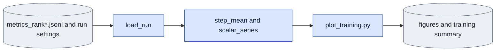

# `plot_training.py` — make readable training curves

The module has `step_mean`, `scalar_series`, `_smooth` and four plot functions.

## Objective

Turn the training logs of each GPU process into curves and a
`training_summary.json`. The curves show what each optimizer update saw, how
the gradients behaved and how long training took. These are training
diagnostics. For video quality, use the separate
[media previews](media.md#training-preview-layout).

## Usage

Run the module directly on CPU, from `LTX-2` in the `ltx` environment. It loads
no model. See [run guide §8](../configs/README.md#8-decoding-comparison-media-cost-and-plots).

```bash
cd LTX-2
"$PY" -m scripts.onestep_avatar.plot_training \
  --run ../expr/onestep_avatar/runs/<RUN_A> --label A \
  --run ../expr/onestep_avatar/runs/<RUN_B> --label B
```

| Argument | Meaning |
|---|---|
| `--run` | Required. A `train.py --output` directory. Repeat it to compare runs. |
| `--label` | One label for each `--run`, in the same order. The default is the directory name. |
| `--output-dir` | The figure directory. The default is `figures/` next to the first run. |
| `--smooth N` | The moving-average window in updates. The default is `total_steps // 40`, at least 1. |

Outputs in the figure directory: `loss_curves`, `lr_grad_norm`, `throughput`
and, for causal runs, `block_position`, each as PNG and PDF. Also
`training_summary.json` and an `INDEX.md`.

## Data flow



The engine logs give the update, process, sample, sigma, unscaled loss,
gradient norm before clipping, learning rate and elapsed time. Causal logs also
give the block positions. The reader never loads model weights or makes
evaluation videos.

## Organization logic

### Required log format

`load_run` requires a `config.json` with an explicit supported `mode` and a
positive `world_size`. `world_size` is the expected process count. Each update
record must have these properties:

- It is schema two.
- It has a nonempty `samples` list, and each sample names its `source`.
- Causal position values come only from each sample's `per_block` list.

A log without these fields fails with a clear error. The reader does not
reinterpret it. It never relabels a window position as a causal block.

### Read and aggregate logs

1. Read each process log in update order with the saved run settings.
2. Group the records by completed optimizer update. Do not group by block
   number or by line number.
3. Check which expected processes supplied the update. Refuse duplicate
   `(rank, step)` records and a file that contains another rank.
4. For a complete update with equal nonzero sample counts on all processes,
   average the unscaled process losses. Each process loss is the mean of its
   sample losses. Each causal sample loss is the mean of its block means.
5. Read the learning rate and the synchronized gradient norm once. Record the
   largest disagreement between processes. Do not average away a disagreement
   in values that must match.
6. Take the largest cumulative elapsed time over the processes at each update.
   Subtract consecutive values to get the wall time of each update.
7. Write the raw aggregated values and the display settings with the summary
   and figure data.

`step_mean` requires complete process coverage and equal accumulation counts.
An incomplete update stays out of the batch mean, the timing, the position
curves and the summary. The figure keeps the available process traces of that
update and marks it with a dotted marker. The loss of a missing process is
never filled with zero. The summary records the covered and expected process
counts.

`elapsed_s` is the cumulative wall time of the run. Its differences can include
saves or other work. They are not model-only timings. [bench](bench.md) owns
those measurements.

The gradient norm that clipping returns is the norm before clipping. The label
says so.

### What the figures show

| Output | Layout and axes | Reading rule |
|---|---|---|
| `loss_curves` | One row for each active loss field. x = completed updates. y = unscaled full-frame MSE or loss. | A thin raw mean and a bold smoothed mean. Optional faint process traces. |
| `lr_grad_norm` | Separate learning-rate and gradient-norm panels on a shared update axis. | Show both values without combining their units. Report the process disagreement. |
| `throughput` | Update seconds on the left axis, cumulative minutes on the right axis. | Use the elapsed time of the slowest process and the actual update gaps. |
| `block_position` | Causal only. One labeled line for each position in the sampled block sequence. | Aggregate the MSE of that position over samples and processes at each update. |

- In bidirectional mode, there is no block-position figure. The index marks it
  as not applicable.
- The block position is relative to the sampled sequence. It is not always
  block zero of the original video.
- The history comes from the recorded forcing policy. A position label alone
  does not prove generated history.

Display rules:

- Titles name the measured quantity. Axes state the units.
- Use the same color and line style for a run in all figures. Put legends
  outside dense data.
- A multi-run label names the changed factor and its exact value.
- The caption states the shared mode, data and level settings and the
  smoothing width once.
- Do not suggest comparable loss scales when data, background, sigma exposure
  or loss definitions differ.
- Keep the raw curves, so smoothing cannot hide a single failure.

### Smoothing and summaries

`_smooth` limits the window `w` to the series length. It uses an equal-weight
trailing window. It repeats the first full-window mean in the first `w-1`
display positions. Those first values are display padding. They are not
observations at those updates. The summary records this rule.

Summary values always use the raw complete-update means:

- the final scalar values;
- the minimum raw mean loss and its update;
- the mean raw loss over the last `max(1, floor(updates/10))` updates;
- the elapsed minutes and the number of distinct input videos;
- the process coverage, sigma counts, smoothing settings and loss definition.

Do not use a smoothed minimum as evidence for the best checkpoint.

The `per_window` and anchor plotting branches are removed. An inventory of 64
avatar process logs found no `per_window` records and no nonzero anchor values,
so no old record needs conversion.

## Invariants

- Plotting reads saved logs and creates no model session.
- The process, sample and block averaging matches the training loss
  definition.
- Missing values are not zero observations.
- A learning-rate or gradient disagreement stays visible.
- Raw values, not smoothed curves, give the summary statistics.
- Different modes have explicit labels and only the plots that apply.

## Gotchas

- A lower training loss alone does not prove better identity or motion.
- Random sigma draws give equal exposure only on average. Show the actual
  counts when you compare runs.
- Learning rate and gradient norm have different units, so they need separate
  axes.
- No constant from another run is a reference floor for a new video list or
  task. If a report needs a reference line, use current saved controls.

## Tests

Worked aggregation check:

- Process losses 2 and 6 at one complete update give a batch mean of 4.
- Equal learning rates stay one scalar. Different gradient norms give a
  disagreement value.
- Cumulative times of 10 and 12 seconds give an update wall time of 12 seconds.
  The next update's times of 18 and 21 give 9 more seconds.
- If one process record is removed, that update is incomplete. It is not a
  two-process mean with an invented zero.

Worked mode check: bidirectional logs give the loss, learning-rate and
gradient, and timing figures. They give no position figure. Causal logs label
the sequence positions from the saved records.

The tests verify raw aggregation, incomplete coverage, refusal of logs without
the required fields and the summary formulas. Inspect the axes, legends and
smoothing note at normal and narrow display widths. Unchanged logs must rebuild
the same figures and summary without training, transformer or VAE execution.
