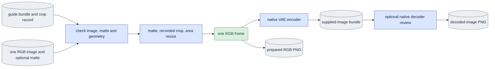
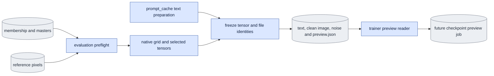

# `prepare_inputs.py` — checked product and preview input preparation

## Objective

The module has two operations:

- `supplied-image` makes a supplied-image bundle from one actual RGB image. It
  never uses a slice of a video master.
- `preview` assembles the fixed inputs of a training preview from checked
  masters and prepared reference pixels.

Preparation stays outside training and product generation.

## Usage

Run both operations directly from `LTX-2` in the `ltx` environment, on one free
GPU that you select. Check `nvidia-smi` first. Neither operation opens a
transformer.

### `supplied-image`

See [run guide §7](../configs/README.md#7-product-generation-from-a-supplied-image).

```bash
cd LTX-2
"$PY" -m scripts.onestep_avatar.prepare_inputs supplied-image \
  --image <RGB_IMAGE> --mask <GRAYSCALE_MATTE> --guide <WHITE_GUIDE_BUNDLE.pt> \
  --output <FRESH_INPUT> --gpu-id <FREE_GPU> --review
```

| Argument | Meaning |
|---|---|
| `--image` | Required. One RGB image on the original canvas of the guide crop. |
| `--guide` | Required. The guide bundle. Its crop and VAE records apply to the image. |
| `--output` | Required. A new output directory. |
| `--gpu-id` | Required. A free GPU. |
| `--mask` | A grayscale matte of the same canvas size. Required for a `white` guide. A `bg` guide refuses it. |
| `--review` | Also save a VAE-decoded still image. |
| `--model {2.3,2.5}`, `--seed` | The VAE version and the decode seed. |

Outputs in `<FRESH_INPUT>`: `image.pt` (the bundle for `infer --first-image`),
the prepared RGB PNG, the decoded PNG with `--review`, and the preparation
record.

### `preview`

See [run guide §6](../configs/README.md#6-fixed-training-previews).

```bash
"$PY" -m scripts.onestep_avatar.prepare_inputs preview \
  --references <REFERENCES>/references.json --output <FRESH_FIXED> --gpu-id <FREE_GPU> \
  --evaluation-arguments --mode bidirectional --subset <MEMBERSHIP.json> --source <VIEW_ID> \
  --variant dev --guide-mode d1 --span-latent-frames 7 --schedule 0.725 0 --include-base
```

| Argument | Meaning |
|---|---|
| `--references` | Required. The `references.json` from [`media --prepare-training-references`](media.md#usage). |
| `--output` | Required. A new output directory. |
| `--gpu-id` | Required. A free GPU. Only the VAE and the text encoder load. |
| `--evaluation-arguments ...` | Required, and last. Ordinary [evaluation arguments](evaluate.md#usage) with exactly one `--source`. |

For a causal adapter, use its training settings, and set the generated length
with `--output-latent-frames`. The evaluation arguments must not contain
`--output`, `--gpu-id`, `--checkpoint`, `--dry-run` or future-noise options.

Output: `<FRESH_FIXED>/preview.json` and the pinned tensors. Give
`preview.json` to training as `--preview-inputs`.

## Data flow



## Organization logic

### Supplied images

**Input checks.** The command reads the guide with the checked master reader.
It requires these items:

- the current registered VAE fingerprint;
- a finite, square crop inside the canvas, with a positive edge aligned to the
  scale;
- matching guide channels, spatial shape and encoding contract.

It reads exactly one RGB image. It refuses an animation and an implicit alpha
conversion. A `white` image needs a grayscale matte with the same original
canvas size. The command does not infer a box for each image. It does no
centering, stretching, EXIF rotation or thresholding.

**Pixel preparation.**

1. Use the guide's box on the original image canvas.
2. For `white`, blend continuously:
   `round(rgb*alpha + 255*(1-alpha))`, with `alpha = mask/255`. For `bg`,
   use the RGB directly.
3. Crop and resize with the shared fitted-crop helper and OpenCV
   `INTER_AREA`. This matches the capture preprocessing.
4. The prepared pixels are uint8 HWC. Normalize them to `[-1,1]`.
5. Pass native bf16 `[1,3,1,edge,edge]` to exactly one
   `tiled_encode(pixels, None)` call.
6. Require a finite `[1,C,1,H,W]` output with the guide's channels and spatial
   size.

**Record.** The command saves a version-two master record with these fields:
`input_role=supplied_image`, `pixel_frames=1`, the matching objective, fps,
crop, edge, VAE fingerprint and encode contract. It adds the content hashes of
the image, mask, guide and VAE, the prepared-pixel identity and the shared
preparation software manifest. The guide stays unchanged. Its first latent
frame is never changed or relabeled.

**Order.**

1. Hash all input bytes before reading.
2. Check the input hashes again after the checks, after the encode and after
   the optional decode.
3. Check the saved software manifest before the model loads and before
   publication.
4. Refuse an existing destination.
5. Save the prepared PNG and the bundle, then the optional decoded PNG.
6. Publish the complete preparation record last.

The record keeps the elapsed time and the CUDA allocated and reserved peaks.
These are separate from quality claims.

### Fixed previews



The arguments after `--evaluation-arguments` use the ordinary evaluation
parser. The command requires one explicit source. It refuses the options that
execution owns: output, GPU, checkpoint, dry run and future noise.
`--include-base` adds an optional base comparison. The command reuses the
ordinary data, schedule and geometry checks. It opens no transformer.

**References.** The command loads and verifies the reference bundle before any
text work. It binds the source, objective, capture and guide content, fps, VAE
and the exact RGB frame coverage.

**Canonical arguments.** The command freezes the membership, the optional frame
plan, the source bundle bytes and the reference manifest. It writes all path
arguments as absolute paths. It writes the selected encoded-frame count
explicitly:

- **Causal previews** keep the parsed training span exactly. The command omits
  `--span-latent-frames` when the span is null, and keeps an explicit value.
  It pins the physical coverage with `--output-latent-frames`. The value is
  the requested count, or the complete-block count from the evaluation checks.
- **Bidirectional previews** keep their explicit selected span.

The command removes all original path, noise and length options, including the
`--flag=value` forms. Then it adds each canonical argument once. So the E4
null-span contract stays null when seven-frame noise is prepared. An explicit
span-7 pilot keeps its own training settings.

The command parses the canonical arguments again before any text or GPU work.
An explicit span 8, which evaluation trims to 7, cannot be prepared as span 8
with output 7, because explicit paired lengths must agree. Evaluation without
`--output-latent-frames` keeps its trimming behavior.

**Tensors.**

1. Generate native-bf16 noise on the selected GPU with the ordinary sampler's
   seed, or reuse a checked supplied noise tensor. Save the actual token
   tensor.
2. Patchify through the same native grid as evaluation.
3. Pin the hashes of the capture, the guide when used, the clean first capture
   frame, the positive text and the noise.

The first frame of the preview is the training capture encoding. It is not a
product supplied-image bundle.

**Text.** The positive text comes from the shared prompt-cache owner. For a CFG
scale other than one, the command also prepares and pins the negative text.
STG or rescale without CFG does not create a negative context.

**Publication.**

1. Save the text, image and noise tensors.
2. Write the version-two `onestep_avatar.preview_inputs` record. It contains
   the evaluation arguments, the reference identity and the preparation
   software.
3. Validate the record with the trainer's actual `read_preview_inputs`.
4. Publish the final record.

The command checks the input files and the software before the text models
load, after preparation and before it publishes the complete record.
Non-tensor inputs are frozen in `producer_inputs`. The shared reference checker
checks those bytes in training checks and in preview jobs.

Give the record to training as `train.py --preview-inputs <DIR/preview.json>`.
Each completed checkpoint then adds a generation and rendering job outside
FSDP. Preparation does not add or generate a preview itself. It never rewrites
saved reference or input provenance. A changed preparation source changes the
software identity. Prepare fresh records. Do not rewrite saved ones.

## Invariants

- One RGB image and one encode call make the image latent.
- No transformer opens. Supplied-image preparation opens no text encoder.
  Preview preparation can build text through the shared prompt-cache owner.
- The crop, background and VAE metadata describe the actual operations on the
  actual pixels.
- A `white` objective requires an explicit matte. `bg` never uses one.
- A failed input or software check cannot publish a complete record.
- The current producer software never restamps saved bundles.

## Gotchas

- Give the image in the original canvas coordinates of the guide crop.
- A matching shape does not prove a matching identity or pose.
- For a matched pilot, export the source frame and the matte as lossless
  images. Record their provenance. Compare the prepared PNG with a replay of
  the capture preprocessing.
- A single-image VAE encoding can differ from the first frame of a continuous
  video encoding. Measure that difference. Do not change metadata to hide it.

## Tests

Supplied-image tests check these items:

- exact crop, continuous matte and area-resize pixels;
- one-frame native encoder arguments;
- bundle compatibility with the product reader;
- unchanged inputs;
- refusal, before publication, of missing or extra masks, animation, a bad
  crop, wrong VAE or guide dimensions, changed inputs or software and bad
  encoder output.

Worked check: RGB 0 and matte 128 give `round(255*(1-128/255)) = 127` before
the resize. A seven-frame guide still gives exactly one image latent.

An independently encoded image differs slightly from the first frame of the
continuous capture. On one `white` view, the measured RMS was 0.0044 and the
maximum was 0.047. So product inputs always use the supplied-image encoding,
never a frame of the capture master. Native encode and decode and matched
capture pixels need separate saved GPU evidence. Controlled tests do not prove
native correctness.

Preview tests cover:

- both modes, D0 without a guide and D1;
- fixed positive and negative text, and exact noise and image hashes;
- acceptance by the trainer and job readers;
- refusal of wrong reference coverage before text work, multiple sources,
  owned flags, changed membership or frame plan and changed software.

Coverage tests use real 18-frame masters and the E4 contract (null span,
frame counts `[6,7]`). They prepare seven-frame inputs and pass the arguments
through ordinary evaluation and the strict adapter checker. The trainer reader
must accept the unchanged null span. An explicit span-7 pilot stays strict
under its own contract. The tests check both the split and `=` option forms,
no duplicates, unchanged bidirectional selection and refusal of transferred
settings before the weights load. A prepared record alone does not prove
native preview generation.
