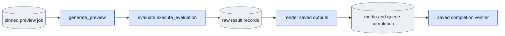

# `previews.py` — pinned training previews

A preview generates and renders the same fixed inputs at each saved training
checkpoint. You can then compare the checkpoints on the same inputs.

## Objective

This module owns these parts of a preview:

- the fixed preview records;
- the locked state changes of a preview job;
- raw generation;
- rendering of the saved outputs.

Training adds a preview job to the queue. This module calls ordinary
evaluation with its one tensor validator. It has no trainer or sampler of its
own.

## Usage

Humans can use the foreground queue or run this module directly.
See [launch, output and stop commands](usage.md). Agents use the queue.
The queue recipes below describe managed execution.

Start a preview as a queue `preview` job. The queue selects the GPU. See
[run guide §6](../configs/README.md#6-fixed-training-previews).

This is the agent path. A person can also run the same module directly, or start the queue in the foreground; see [usage](usage.md).

1. Prepare the reference pixels with
   [`media --prepare-training-references`](media.md#usage).
2. Pin the fixed inputs with [`prepare_inputs preview`](prepare_inputs.md#usage).
3. Give `<FIXED>/preview.json` to training as `--preview-inputs`. Each saved
   checkpoint then writes a preview job file.
4. Run each preview job file as a queue job:

```json
{"id": "preview_step20", "kind": "preview",
 "arguments": ["--preview-job", "/abs/run/preview_jobs/<ID>.json", "--output", "/abs/run/previews/<ID>"],
 "output": "/abs/run/previews/<ID>",
 "completion": {"records": ["/abs/run/previews/<ID>/preview_completion.json"]}}
```

Training writes each job to `<run>/preview_jobs/<ID>.json`. Its output is
fixed to `<run>/previews/<ID>`, and `--output` must name that directory.

| Argument | Meaning |
|---|---|
| `--preview-job` | Required. The pinned preview job file that training wrote. |
| `--output` | Required. It must equal the output in the preview job, `<run>/previews/<ID>`. |
| `--gpu-id` | Set by the queue. Local device zero by default. |

The result shows these panels on matched frames: capture RGB, VAE-decoded
capture, guide, base and adapter. A failed preview does not change training.

Outputs in `<run>/previews/<ID>`: numbered `attempt_NNNN/` directories with raw results, the
rendered video and poster, and `preview_completion.json`.

## Data flow



Rendering reads the fixed reference bundle and the raw records. It opens the
shared VAE session and decodes only the requested outputs. Then it calls the
shared media owner.

## Organization logic

### Arguments and identity

The parser reads no scientific files. The explicit output must equal the
pinned job's output after path normalization.

`queue_identity(arguments)` gives the fixed identity of the job: the job ID,
the checkpoint record, the fixed-input hash and the output. It does not bind
the hash of the whole job file, because this module updates the job's state
and result list during work.

Worked check: a state change or new media changes the job-file SHA, but not
`queue_identity`. A changed checkpoint or fixed-input hash changes the
identity or fails the check. A deleted poster fails saved completion.

### Checks before generation

`verify_preview_job` checks these items. It runs no model or decoder.

- the job ID against the checkpoint and fixed-record hashes;
- the checkpoint completion marker and all fixed file hashes;
- the actual version-two adapter matrices and step, through the public
  metadata and tensor checker.

The fixed record can have a `reference_bundle`. It pins an absolute manifest
path and the full file hash. The check loads its pixel records and requires:

- its capture-encoding hash equals the fixed capture file hash;
- its source equals the one explicit evaluation source;
- for D1, the guide RGB identity matches the encoding fingerprint of the
  pinned guide bundle. A D1 bundle with no guide is invalid. Null values do
  not prove a matching guide identity.

Reference pixels or a bundle from another source fail before generation. Older
raw-only records can omit this field. They cannot claim complete reference
rendering. The shared reference checker also verifies non-tensor
`producer_inputs`, for example the membership and frame-plan bytes.

### Job state

`set_preview_state` locks each job file and writes JSON atomically. The allowed
state changes are:

| From | To |
|---|---|
| `pending` | `running`, `failed` |
| `failed` | `running` |
| `running` | `complete`, `failed` |
| `complete` | none |

- A different live PID cannot replace the running owner.
- A failed state requires a reason.
- A complete state requires current raw results and video and poster records,
  matching job and fixed identities and at least one pinned adapter result.
- A failed-state update checks the fixed job identity, but not unchanged input
  bytes. This lets the module record an input-corruption failure. The running
  and complete changes still verify all pinned files.
- Checkpoint bytes and the completion marker stay read-only.

### Generation

`generate_preview(job_path, gpu_id=...)` is the raw generation stage. It
accepts no study-setting overrides. It does these steps:

1. Verify the fixed files and the completed adapter. If this first check
   fails, record a failed state on the pending job before claiming it. Do not
   change a job that another process owns or a terminal job.
2. Claim the job under its state lock.
3. Build the evaluation arguments from the saved settings. Add the pinned
   checkpoint and the first unused `attempt_NNNN` directory. Never change the
   training settings or overwrite an earlier failed attempt.
4. Read the fixed text tensor directly. Do not rebuild text from a prompt. Load
   the saved negative text when CFG uses it. Never rebuild it from the prompt
   cache.
5. Pass the typed arguments and `preview_fixed` to the evaluator. Pass the
   public `verify_preview_tensors` as `preview_tensor_validator`.
6. Before each transformer opens, compare the actual capture, guide,
   first-image, text and saved-noise tensor hashes with the fixed record. A
   mismatch fails before any transformer call.
7. After generation, verify the saved raw records and their encoding hashes.
   Record these results on the running job.

The evaluator refuses a fixed preview without the validator, before native
handles, weights or writes. It calls the validator after it assembles the
execution tensors. This module imports `evaluate` in one direction only.
`evaluate` imports no previews module.

The tensor checker hashes the shape, the dtype and the tensor bytes through
`hashing`. It checks every pinned tensor except the subset file. All pinned
tensor roles are required.

A saved `--noise-file` holds one finite native-bf16 token tensor for one
video. The check verifies its shape. Execution uses the retained CPU tensor.
It does not read the file again after the weights open, and it does not change
the dtype.

Raw generation alone cannot complete the job. Any ordinary failure records
`failed` with the exception type and message, and then raises the error again.

### Rendering

With a reference bundle, rendering follows raw generation in the same process.
`render_preview_outputs` does these steps:

1. Verify the saved raw results, the reference hashes, the source, fps and
   coverage, the native decoder settings and the native VAE hash.
2. Check the exact reference and output titles with `media.layout_geometry`.
   Use the normal training layout when it fits. Otherwise use the compact
   planner. If neither fits, fail before decoding. The checkpoint stays intact.
3. Require exactly one pinned adapter result and at most one base result.
4. Decode the saved encodings with the reference decode seed. Do not open the
   transformer again.
5. Show the three references above the base and adapter outputs. If no base
   result was requested, label that panel as missing.
6. Save the actual decoder identities and links to the raw result records.

A changed Torch version or decoder configuration fails before the decoder
opens. Prepare new references for that runtime. A rendering failure goes to the
failed-job handler of the generation stage. There is no separate render-only
recovery. Native preview acceptance is part of E4.

The panels are: recorded capture, VAE-decoded capture, guide, the optional base
and the pinned adapter output. They keep the exact source frames and fps, and
the shared equal-height layout rules. A missing base output is labeled.

Preview rendering records the decoding software profile before the checks. It
checks the profile again before the VAE session and before publication, and
saves it in each rendering.

### Completion

After a queued preview reaches the complete state, the module publishes
`preview_completion.json` under its output. The marker binds the fixed
identity and the exact lists of raw and render records.

`verify_completion(arguments, root)` checks these items again:

- the marker and the current complete job;
- every fixed input and the checkpoint;
- the public raw and render verification;
- that each generated file stays inside the pinned output;
- the raw encoding's shape, finite native precision and clean first-image
  bytes.

Raw completion uses the shared evaluation verifier with the fixed arguments,
the pinned adapter and the exact numbered attempt. Rendering must identify the
same raw attempt, decoder keys, native VAE bytes and pinned references. The
check covers the reference pixel hashes, panel roles, titles and positions,
source-frame map and fixed media paths.

`evidence_paths` returns the marker, every raw and render record, the encoding,
the video and the poster, after verification. It opens no model or decoder and
repairs nothing. The queue can call `evidence_paths(..., verified=True)` only
after it ran this verifier in the same receipt check. Direct callers keep the
default `verified=False`.

Every run requires an explicit output that matches the preview job. Completion
always requires rendered evidence. The module never creates absent reference
data.

**Marker recovery.** Rendering can complete before the process stops, with no
marker written. Then the queue CLI verifies the saved complete job and
publishes the marker without generation. If the marker exists, the CLI
verifies it and changes no bytes. Saved verification itself never writes or
repairs records.

Worked check: `attempt_0000` failed and stays unchanged. A retry writes
`attempt_0001` with the same checkpoint and fixed inputs. A changed noise
tensor fails before the transformer loads and records its reason. The
checkpoint bytes and the completion marker stay unchanged.

## Invariants

- One validator owns the fixed tensor checks. The evaluation software receipt
  includes this validator owner.
- Never change a training or checkpoint file.
- Completion requires raw and rendered evidence under the same running owner.

## Gotchas

Generation and rendering are separate evidence stages. A saved raw output alone
cannot certify complete preview media. Keep the original retries and receipts.

## Tests

`test_previews.py` keeps all state, change, retry, rendering and pin checks. It
also checks:

- a missing validator fails before native handles or writes;
- the validator reaches ordinary evaluation;
- CLI help uses `--preview-job`.

`test_ordinary_queue_completion.py` adds these checks:

- the identity stays the same when the job state changes;
- complete queued raw and render execution on a controlled CPU model;
- marker-only recovery;
- failures for missing media and for changed shape, precision, `c0`, time map
  and decoder.

Native model and decoder access stay blocked during saved completion.
