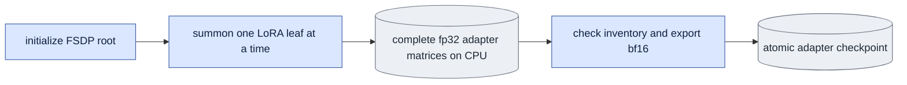

# `training/checkpoints.py` — save adapters and check their settings

This module owns adapter saves, parent initialization, typed contract checks
and tensor validation. Normal training, evaluation and product execution
require the version-two record that this document describes. The eight-block
causality diagnostic has a separate flat-metadata condition checker.
`model/sampling.py` owns schedule validation. This owner starts no model or
CLI execution.

A **contract** here means the recorded training conditions of an adapter.

## Objective

Use one adapter settings record and one checker. Check requests before the
model weights load.

- Evaluation can record an explicit research override.
- Product generation refuses incompatible requests.

**Precision contract.** Every record declares `training.global_sigma_dtype`
from the shared ordinary runtime constant. Execution requests declare the same
condition.

- A contract without this field, or with an unknown value, is invalid. It is
  refused, even with a research override.
- An explicit `bfloat16` calibration can differ under a recorded research
  override. The product refuses the difference.
- Do not infer the calibration from the weight dtype or from current defaults.
- Parent tensor initialization does not inherit the calibration of another
  stage. The new stage records its own actual training precision.

**Application method.** The requested `application_method` is required. It must
name `peft_unmerged_fp32` or `fused_bf16`. It is compared with the recorded
training application before the weights load. A supported changed method needs
the existing research override. The product always refuses the difference. A
missing or unsupported method is a malformed request and cannot be overridden.

**Parent initialization.** Parent-stage tensor initialization uses
`model.adapters.load_weights`, the same strict exported-matrix owner that
inference uses. It requires the complete PEFT matrix list, the shapes and finite
contents. Missing base-model keys are expected. Missing adapter keys are not.

## Data flow

1. Read the training settings and the data and frame-plan hashes. Write the
   adapter record.
2. Read that record and the requested generation settings. Check
   compatibility.
3. Return a compatible request or a named list of differences.

The ComfyUI tensor key format stays the same.

## Organization logic

### Export the adapter matrices

The module exports only the adapter matrices.

1. Initialize the root hierarchy first, through the public FSDP
   `check_is_root()` method. The outer transformer must be the root. This sets
   all nested wrapper roles without unsharding frozen weights. If an
   uninitialized leaf were summoned first, it would become a root by mistake
   and fail the first forward.
2. Under FSDP, all ranks summon each separately wrapped LoRA leaf, one at a
   time. Rank zero copies its full fp32 parameters to CPU.
3. Never request a full frozen-transformer state dictionary only to discard it.
   One-rank NO_SHARD would clone the resident frozen model on GPU and could
   exceed the unchanged 48 GB allocated-memory limit.
4. Verify that the collected names equal the complete named LoRA list.
5. Let PEFT do its canonical adapter selection, and let the existing writer do
   its bf16 export conversion.

Ordinary non-FSDP export uses the same PEFT selection. The serialized tensors,
the metadata, the zero check and the atomic publication stay one calculation
here.

Worked check: the complete wrapped model has 768 named LoRA matrices. Every
rank visits the same 768 leaves. Rank zero collects all 768 canonical names. No
frozen tensor enters the CPU payload. A missing leaf fails the list check
before publication. An initial adapter with all B matrices at zero exports the
same canonical values as the ordinary PEFT path.

### Completion marker

The engine's completion marker binds the saved config, its original
`queue_launch` record and the observed applied-runtime evidence. Adapter
metadata describes the scientific conditions. It cannot prove which launcher
or FSDP policy was applied. So queue completion and replay check both the
adapter contract and these original config and marker facts. A record without
launch facts cannot pass replay.

The shared `queue.read_training_marker` reader validates the actual completion
state, the integer schema and step, the checkpoint path and the checkpoint byte
hash. Queue completion, training provenance and replay use this one readiness
check. This module owns the adapter contracts. A valid contract alone does not
prove readiness.

### Record format

The JSON is stored in safetensors string metadata under
`onestep_avatar_contract`, with `schema_version=2`. The root fields are
`schema_version`, `mode` and `attention`. The record has exactly these objects:
`model`, `task`, `shape`, `training`, `data`, `adapter` and `mode_settings`.
Only causal records have a `causal` object.

- `model`: the version, the variant, the base file name and the full base
  SHA-256.
- `shape`: the channels, the encoded height and width and the supported
  selected frame counts.
- `training`: the exact levels and direct schedules, the draw rule, the noise
  rule and the seeds.
- `data`: the list and plan hashes and the sample coverage.
- `adapter`: the rank, alpha, target name and modules, step, parent,
  application method and exported `tensor_shapes`. A save fills the tensor-shape
  list from the actual exported tensors, before the atomic write.

**Random-start coverage.** For random-start training, the coverage holds window
templates. It does not claim that every update started at zero. The required
`segment_selection` record stores:

- the frame count of each master;
- the inclusive allowed start bounds and the window length;
- the exact seed key and draw rule;
- the accepted random-start first-image difference (`known_gap: "G9"`).

Readers check its consistency with the templates, the mode settings and the
noise seed. A saved frame plan must have the matching `start_draw`. A changed
seed or key with a newly calculated hash still fails. Causal random-start
records also require one block and window length B+1. An omitted bidirectional
window length selects each whole master, whose only allowed start is zero. It
still records the declared random draw descriptor.

| Record | Required facts |
|---|---|
| Model | version, dev/distilled choice, base weight file identity and hash |
| Task | D0/D1, background, `clean_c0_v1`, `full_frame_x0_mse` |
| Mode | bidirectional/causal, attention, encoded frame count and start rule |
| Training | exact sigma levels and draw rule, direct `[sigma,0]`, seeds, noise rule |
| Data | fixed video list hash, frame-plan hash, selected frame coverage |
| Adapter | rank, alpha, target layers, parent stage, update number, training application method |
| Causal only | block length, K, stored past-frame limit, first-frame retention, refresh and priming rule, history policy |

### Functions

- `read_contract` refuses missing or malformed version-two records.
- `contract_condition_problems` compares a complete requested model, task,
  mode, shape, schedule and mode settings. It does not compare people or
  membership hashes.
- `check_contract` allows a research override only when the caller asks for
  one. The product path cannot override differences.
- `validate_adapter_tensors` checks the exported keys, the paired A/B shapes
  and the actual rank, without loading the transformer.

A complete contract does not prove numerical equality of fused and unmerged
application. Result records keep the actual application method.

### What the checker compares

The checker compares the mode, the base weights, the task, the sigma levels,
the schedule and the mode-specific frame settings. Training records stay
separate from evaluation inputs.

- Evaluation can use people that training did not see.
- A random-start-trained adapter can be evaluated from frame zero if the
  difference is recorded. The
  [random-start first-image gap](../known_gaps.md#random-start-first-image-distribution)
  still applies.
- An adapter trained with capture past frames uses that history for an
  evaluation under the same conditions. Generated-history evaluation changes
  those conditions and must be labeled.
- Product generation has only generated past frames.

**History fields.** A causal execution request requires `history_mode` and
`kv_source`, outside `mode_settings`. The recorded refresh calculation
`cached_refresh_global_sigma0` maps to `history_mode="cache"` and
`kv_source="refresh"`. Both are compared before the weights load.

- Recomputed or joint history, or K/V from denoising, changes the trained
  calculation. It needs the existing research override. The result saves each
  field, its trained and requested values and the reason from the refresh
  calculation.
- Product requests use `cache`/`refresh` explicitly and allow no override.
- These settings do not change the training mode or the global-sigma-zero
  refresh of the cache.
- Missing or unsupported history fields are malformed requests, not research
  conditions. They are refused, even with an override.
- K/V from denoising supports only cached generated history.
- Bidirectional requests cannot contain history fields.
- Base-only diagnostics have no adapter calibration to override. Their result
  conditions still record the explicit history and K/V settings.

Worked check:

- A matching causal request with `cache`/`refresh` has no differences.
- Change only `history_mode` to `recompute`. The ordinary and product checks
  fail. Research evaluation with an explicit override returns a `history_mode`
  difference that cites `cached_refresh_global_sigma0`.
- Change only `kv_source` to `denoise` with cached generated history. The
  result is a `kv_source` difference under the same rule.
- Omit either field. The check fails, with or without the override.

The checker names all differences. Evaluation needs an explicit override to
continue with a difference, and it saves that list with the output. Product
generation fails on the difference. [model/sampling](../model/sampling.md)
checks the base's supported noise levels separately.

### Read and decide before the model loads

1. Read the safetensors header and parse the one structured JSON record. Check
   the schema version, the required fields, the mode, finite levels and the
   mode-specific fields.
2. Inspect the adapter tensor keys and shapes and the alpha/rank support,
   without opening the base model. A malformed record or an unusable tensor
   layout fails. An override cannot make it loadable.
3. Resolve the requested base identity and the exact schedule with shared
   helpers.
4. Compare the recorded conditions with the requested conditions, field by
   field. Return each difference with the field name, the trained value, the
   requested value and the reason.
5. Do not compare evaluation membership with training membership for
   compatibility. Save both identities as provenance. Check the evaluation
   files against their own pinned list.
6. With no differences, return a checked request. With evaluation differences,
   require the explicit research override and return its difference list. With
   product differences, fail. Never repair the requested mode or schedule
   quietly.

Compare exact sigma and schedule values, not rounded text or directory names.
Record random-start and frame-zero changes, and recorded and generated history
changes, explicitly. Base support, adapter calibration and actual tensor
loadability are separate checks.

### Recheck a checked adapter before loading weights

The public `recheck_adapter(path, contract, expected_sha256)` owns the repeat
check after an ordinary caller's preflight.

1. Require the complete expected file digest. Compare the current bytes.
2. Use the existing `read_contract` and `validate_adapter_tensors`.
3. Compare the checked metadata record.
4. Compare the file bytes again.

A missing or changed identity, changed metadata, incomplete keys or wrong
matrix shapes or rank fail before the model opens. This calls the one current
validator. It creates no second schema implementation.

Ordinary evaluation, the product and the acceptance comparisons call it
immediately before their model context. `model.adapters` receives the checked
contract and the bound digest as data. It verifies the byte identity
independently, without a reverse import. A metadata-only or tensor-only change
after preflight fails. Unchanged adapters keep their tensor payload and
function.

Normal reads, saves, condition checks, tensor validation and
`random_segment_selection` stay shared here. The public `require_digest` is the
one checker of full lowercase SHA-256 syntax for current adapter contracts.

### Save a completed checkpoint

1. All distributed processes take part in the required gather, in the same
   order.
2. The main process rewrites the keys once and validates the tensor keys and
   shapes. It builds the metadata from the checked settings.
3. It writes a temporary sibling safetensors file. It closes and validates that
   file, then atomically replaces the final checkpoint path.
4. Only then does it calculate and record the content hash and mark the
   checkpoint ready for evaluation previews.

Readers require the same checkpoint path and content hash in a complete
version-two marker. Serial replay checks both the step-zero and the
one-update markers before it uses the adapters as accepted distributed
evidence.

On failure, the module removes the temporary file, keeps any earlier completed
checkpoint and creates no preview job for the failed save.

- A freshly initialized adapter's step-zero file must have `lora_B` tensors
  that are exactly zero.
- For a parent-initialized stage, step zero keeps the loaded adapter values and
  the parent identity. It is not a zero-adapter or no-op control.
- Loading parent weights starts a new stage. Exact resume of the optimizer and
  random state is outside this design.

Normal execution requires a complete typed contract. Missing or unclear
conditions fail before the model loads. A mode label alone cannot prove the
frame selection, the conditioning or the calibration.

## Invariants

- Bidirectional records contain no causal history fields.
- The base identity uses a file hash, not only a version name.
- Exact levels are saved without rounding.
- LoRA alpha/rank scaling is applied correctly, or unsupported scaling is
  refused.
- Results record the actual fused or unmerged application method.
- A training-data hash does not forbid evaluation on other people.

## Gotchas

- Fused bf16 LoRA and unmerged training LoRA differ numerically
  ([known gaps](../known_gaps.md#fused-adapter-application)). Metadata does not
  fix this.
- Matching exported keys do not prove equal predictions.

## Tests

The adapter-only export test uses real tiny LTX/PEFT matrices with controlled
FSDP contexts. It requires root initialization before any leaf. It checks
complete matrix ownership and exact PEFT payload equality, and it refuses
full state-dict collection. A native one-rank sequence (export zero, forward
and backward, export one) checks the actual Torch hierarchy separately.

[V7–V8](../verification.md) check incompatible requests and fixed data
identity. The tests also cover record read and write, missing fields, mixed
levels, override records, zero initialization, alpha scaling and incomplete
adapter contracts.

Worked check: an adapter records bidirectional, dev, D1, `white` and direct
sigma 0.5.

- A causal request names the mode difference. A request at 0.7 names the sigma
  difference.
- Evaluation without an override, and all product requests, fail before the
  weights load.
- An overridden evaluation saves every detected difference with the output.
- A change of only the held-out person adds no compatibility difference.
- An interrupted temporary checkpoint save creates no ready checkpoint and no
  preview job.

Rejected requests load no model. Real-weight LoRA application checks run
separately.
