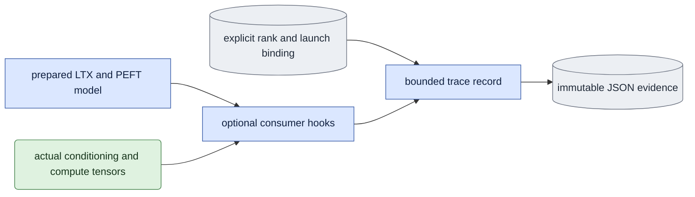

# `training/consumer_trace.py` — optional applied-input evidence

## Objective

Observe the tensors that the installed LTX and PEFT modules actually consume.
This optional diagnostic selects no scientific setting. It casts no tensor,
replaces no forward and changes no gradient. Ordinary training installs no
hooks.

The trace separates two kinds of observation:

- adapter storage, observed outside a forward;
- adapter weights and activation dtypes, observed inside a forward.

It supports the R3 diagnosis. A CPU trace does not certify native FSDP updates
or numerical agreement.

## Data flow

The caller supplies the prepared model and an explicit identity binding: the
rank, the world size, the job digest, the attempt token and the launch digest.
Missing local-launch identities stay `null`. They are never inferred from a
result. The caller starts the trace and wraps each complete `train_sample`,
including the backward, in `sample(mode, step, slot, index)`.

Hooks observe the underlying `LTXModel` after the outer wrappers have forwarded
their inputs. They also observe the AdaLN inputs, the real transformer-block
inputs and PEFT's `lora_A` and `lora_B` linear modules. A record contains JSON
summaries only. The caller publishes a fixed record at a checkpoint. This module
does not write the scientific checkpoint or certify its readiness.

## Organization logic

1. **Setup.** Validate the limits and the identity fields. Find exactly one
   actual `LTXModel` and its actual `BasicAVTransformerBlock` descendants
   through the wrappers. Before the hooks are installed, record the dtype,
   device and local shape of every named adapter parameter. This is an
   observation outside a forward. It is not a gathered master tensor or a claim
   about the hidden storage of an optimizer.
2. **Sample scope.** Start a sample scope with its mode and visit identity.
   Ignore forwards outside the scope. At each LTX consumer entry, record the
   sigma, the per-token timesteps and the positions. Record the latent and
   context metadata, and the independent facts: cache write, cache presence,
   cache start and gradient enabled.
3. **Hashes.** Hash the complete contiguous bytes of each conditioning tensor
   when its element count is within the declared limit. Keep at most 16 sample
   values, plus the finite count, minimum and maximum. Above the limit, record
   the shape and dtype and mark the observation incomplete. Never call a
   sampled hash an exact tensor hash. This limits device-to-host copies.
   Activation records contain shapes and dtypes only, so the per-LoRA hooks
   copy no large activations.
4. **Call labels.** Within a training sample in causal mode, call zero is the
   prime call. Later calls with `kv_write=True` are refresh calls. Other calls
   are denoise calls. Bidirectional calls are denoise calls. These labels
   describe the selected training topology. The independent flags and tensor
   values are the evidence. Labels alone cannot prove a correct call.
5. **Blocks.** Count each real block entry within its LTX call. A later entry
   with gradient checkpointing enabled is labeled `checkpoint_recompute`. At
   that boundary, record the transformed timestep and the RoPE metadata.
   Record the actual AdaLN scaled timestep hashes, and the actual LoRA input,
   weight and output compute dtypes.
   - Transformed block timestep, embedded-timestep and RoPE tensors also get
     complete hashes when they fit the same limit. Larger tensors keep their
     metadata with `hash_scope=not_copied_exceeds_limit`. That marks a missing
     value check. It is not an exact-value acceptance claim.
   - At each adapter forward, record the actual weight byte hash, within the
     same element limit. The first bf16 exports cannot prove that the fp32 A
     values agree. These hashes separate a storage or initialization difference
     from a backward kernel difference. Weights over the limit have no full
     value hash.
   - Non-reentrant checkpointing can stop replay before a post-hook. Its
     pre-hook still records the actual consumer entry. The trace does not force
     replay to finish, disable early stopping or change cache-write behavior.
6. **Errors and limits.** Hooks keep no tensors. Hook observation errors are
   kept, at most 32 text records, and mark the trace incomplete. They do not
   replace the exception of a scientific operation. After the event limit, later
   hook events are counted as dropped without measuring tensors. The same limit
   applies to sample records. A sample exception is recorded and raised again
   by the context manager. Closing removes every installed hook.
7. **Snapshot and publication.** A snapshot is complete only outside an active
   sample, without dropped events, observation errors or failed samples.
   - `validate` checks these facts and the exact optional expected binding.
   - `write` atomically creates an exclusive file. An existing path fails. It
     never restamps evidence.
   - A failed diagnostic can use `write(require_complete=False)` to keep an
     incomplete record. It must not publish that record as checkpoint
     completion evidence.
   - A caller can supply `failure_path` and manage the trace with a context
     manager. On an operation exception, the context writes the incomplete
     observations only if that parent directory already exists. It always
     removes the hooks. Publication failures are logged and keep the original
     operation exception.
   - A failure of the containing operation marks that diagnostic record
     incomplete, even when all earlier sample scopes finished successfully.

Worked check: a bidirectional sample at sigma 0.725, with four clean
first-image tokens.

- The actual LTX consumer records float32 sigma `[0.725]` and float32
  timesteps `[0,0,0,0,0.725,...]`.
- With a BF16 base and fp32 unmerged LoRA, the adapter storage outside the
  forward stays fp32.
- Under CPU BF16 autocast, a LoRA child can consume fp32 input and weights and
  return BF16 output. The trace records all three separately.
- If the installed FSDP recursive BF16 cast is applied before that consumer,
  the sigma, timestep and position dtypes and the exact hashes change. The trace
  must show that change. This control uses the native cast helper, not a
  distributed GPU FSDP run.

## Invariants

- Every event binds one sample, rank and original launch identity through the
  containing record. No saved output hash proves the launch identity.
- Hooks return `None`. They do not replace arguments, results or gradients.
- Exact conditioning hashes refer to observed tensor bytes, with the dtype and
  shape recorded beside them. No full latent, text, weight or activation is
  saved.
- Trace completeness is a data-quality gate, not native numerical acceptance.
- No ordinary setting turns tracing on implicitly. The diagnostic overhead
  affects the measured wall time. State it when you interpret a traced run.

## Gotchas

- The forward compute dtype differs from the persistent storage dtype under
  mixed precision.
- The input dtype and the parameter dtype alone do not prove the matmul output
  dtype under autocast. The post-hook observes the output dtype.
- Hooks see the real wrapped child after FSDP forwarding. An installed or
  compiled wrapper that bypasses hooks is outside the verified scope of this
  diagnostic.
- Contexts must cover the backward, so checkpoint replay is kept.
- Sampling summaries are bounded, but the declared full-byte conditioning hash
  limit can still add CUDA synchronization and memory overhead.
- The trace keeps no live tensors or autograd graph references.

## Tests

`tests/test_consumer_trace.py` uses the actual small LTX model and PEFT
adapters for the training functions of both modes. It verifies:

- output and gradients with the trace on and off;
- float32 conditioning and the prime and refresh roles;
- checkpoint replay and adapter storage against the autocast output;
- hook removal and limits;
- refusal of incomplete or rebound records, and exclusive publication.

An installed FSDP recursive-cast control checks the consumer boundary after the
wrapper, on CPU. It claims no native world-size, collective, memory-budget or
numerical-update acceptance.
