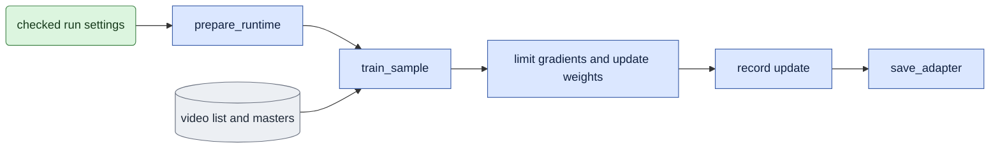

# `training/engine.py` — run shared training

`train.py` delegates to `run_settings` in this module. For the command line,
see the [training Usage section](config.md#usage).

## Objective

Use one implementation for LoRA setup, GPU-process coordination, weight
updates, logs and saves. The selected mode assembles the model inputs and
calculates the gradients. The engine also records visualization jobs and the
completed checkpoint steps.

All training execution stays in this LTX-2 package, including any launcher or
queue. `expr/` can hold study settings and run outputs. Its code only makes
reports from saved results. The engine must not import executable study code.

`train.py` has fewer than 100 physical lines and has no separate design. The
conditioning, loss and cache explanations are in the common and mode
documents. The checkpoint and startup rules are here and in the config and
checkpoint documents.

**Software profile.** The typed runtime records the training software profile
before setup. It checks the profile again before it opens prompt or model
sessions, before each checkpoint or marker save, and before it publishes the
first config and plan bytes. `config.json` and each completed-checkpoint marker
store the profile. The queued verifier requires matching current software in
both the config and the marker. A marker without a manifest cannot certify
completion.

**Adapters.** `model.adapters.attach` owns the shared PEFT configuration.
Training passes its initialization seed and keeps velocity output and
trainable fp32 adapters. Parent initialization uses
`model.adapters.load_weights` through the checkpoint owner, which refuses
incomplete matrices. Ordinary inference uses the same function, frozen and
wrapped once in native x0. The engine owns the FSDP wrapping and the
gradient-checkpointing choices.

## Data flow



Call `train_sample` for each accumulated sample. Limit the gradient size,
update the weights and log once for each update.

## Organization logic

### Checks before setup

`prepare_run(RunSettings)` checks these items before the model loads:

- the version-two video list and the frame plan;
- the actual selected input bytes;
- the sigma levels that the base supports, and the frame dimensions;
- the full base hash;
- the parent records and tensor shapes.

It returns the checked store, the plan, the base specification and the archive
decision.

The typed check compares the VAE fingerprint of every checked capture and guide
encoding with the VAE of the selected base. It uses the producer's file
identity rule. A missing or mismatched identity fails before transformer
hashing, model setup or output archiving. D0 checks the capture only. D1 checks
both. Equal shapes and parent compatibility do not replace this check.

`run_settings` is the only training entry point. `train.py` refuses a command
without `--mode` before any environment change or write
(`tests/test_training_helpers.py`). The queue also requires `--mode` in training
jobs. No setting or adapter from an old command is classified as bidirectional
by default.

The runtime saves the checked frame plan and settings before the first update.
Every update writes a numeric JSONL record. `log_every` controls external
logging, not the numeric evidence.

### Startup events

`run_settings` wraps the typed runtime in `training.startup.StartupEvents`. For
queued attempts:

- Before updates begin, a CUDA `OutOfMemoryError` or a typed port-in-use
  `OSError` emits a contention event bound to the token, job and rank.
- `updates_begin` is emitted before the first training sample, and before its
  forward and backward calls. This early boundary forbids a retry, even if a
  rank updates weights but fails before it writes numeric evidence.
- Other exceptions emit `startup_failed`, which cannot retry, and are raised
  again.
- Network-library text alone is not a retry reason.

Runs outside the queue emit no queue protocol. Argument and input failures keep
their normal behavior. Startup reporting changes no tensor, setting, sigma or
sample selection. The queue owns retry decisions and preservation. The engine
never starts work again.

### Launch, precision and resources

Before model sessions open, the engine reads the dispatch-bound launch record.
It compares the exact arguments and the queue identity. It requires the actual
Accelerator world size and mixed precision to agree. The config and the
checkpoint markers keep that record. After wrapping, `training.runtime` records
the actual policies and adapter storage of each rank, requires rank agreement
and records the complete list. Missing launch or runtime facts cannot certify a
new native replay.

**Budget.** Queued execution uses the exact effective budget from the queue
environment. This includes the canonical defaults when no budget file is
given. The config and the checkpoint evidence record that budget. Completion,
which loads no model, gets the budget from the prepared job and checks every
native rank and phase measurement. Direct execution outside the queue keeps the
explicit-budget behavior.

With `--resource-budget`, `training.resources` reads and pins the budget bytes
before setup. It does these steps:

1. Measure the synchronized local CUDA allocated and reserved peaks and the
   monotonic elapsed time for the load, each update and each export.
2. Save the phase records of each rank and a fixed snapshot for each
   checkpoint. Bind the snapshot hashes in the completion markers.
3. Validate the cumulative phase list before each marker.
4. Check the launch, software and budget again before output creation or
   archiving, and before publication.

A failed phase keeps its measurement and raises the error. It cannot write a
passed marker. CPU tests keep null CUDA quantities and are not native resource
evidence. Sampled total-device observations and the external wall-time stop
guard are separate required evidence. The training update phase includes the
diagnostic Adam-state export. The serial replay includes this export in its
export phase. Their peak measurements use the same allocated limit, but their
phase times have different scopes.

Queued budgeted training also receives a fixed phase-notification contract
from the package supervisor. The local begin and end records of each phase bind
the exact token, job, rank, expected order and budget. External startup and
transition limits are separate from completed CUDA measurements. The engine
does not signal workers or close process records. The supervising queue keeps
the records when absence is unclear.

**Consumer trace.** With `--consumer-trace`, the engine attaches the shared
observational trace after Accelerator wrapping.

- One sample context stays around its forward and backward calculations, so
  checkpoint recomputation keeps the actual sample identity.
- The trace observes the consumer sigma, timesteps and positions, and the
  adapter storage and forward compute, separately.
- Before each checkpoint marker, the engine saves an exclusive trace snapshot
  for each rank and checks completeness. The marker binds the actual bytes.
  Final completion checks these files again.
- Trace serialization is inside the measured export phase.
- A lifecycle context always removes the hooks. If training or export raises,
  it saves incomplete trace observations to a separate failed-rank file.

Default runs install no trace hooks. A trace records the actual consumer
evidence and overhead. It is not a gradient-agreement result.

### Model setup and FSDP precision

After the first checks, the engine builds the Accelerator and the text inputs.

1. Load the frozen bf16 base transformer directly on the local GPU. Do not make
   a full CPU model copy for each process.
2. Use the same LoRA initialization seed on every GPU process.
3. Keep the fp32 trainable adapters, the FSDP wrapping and gradient
   checkpointing.

For typed training, disable the root-input casting of FSDP mixed precision
before wrapping. The input is a `Modality` dataclass. Its sigma, token
timesteps and positions already have the required precision. By default,
PyTorch casts its fields recursively, which changes the numerical function
before the model sees them. For sigma 0.725, the typed model must see float32
0.7250000238418579, not bf16 0.7265625.

- Frozen model blocks keep bf16 parameter and reduction settings.
- PEFT's exact wrapping choices stay. But its separately wrapped trainable
  leaves get no FSDP mixed-precision override. Their fp32 weights and gradients
  must survive the forward and backward interval, as in the serial and
  unmerged product function.
- `CustomPolicy` changes only the mixed precision of the selected trainable
  leaves, not their wrapping membership.
- Autocast still owns the precision of linear compute.

Why: a native trace found bf16 adapter forward weights, even with fp32 storage
outside forward. The first-update B gap stayed above 2% after the
global-conditioning repair. Applied runtime and consumer traces must verify the
fix on native weights. With no mixed-precision policy, there is no root cast to
disable. Every caller passes typed `RunSettings`. Tests check the actual policy
of the shared builder and the installed root-casting function. E4 checks the
native distributed behavior.

### Update loop

For each update:

```text
Select the seeded data group for this process.
Draw one sigma for the update; prepare each sample's noise and start seed.
Check matching model-call and backward plans across processes.
Clear gradients using the existing update order.
For each accumulated sample:
    Load encoded video data and select its frames.
    Call the selected mode's train_sample with Accelerator.backward.
Limit gradient size once.
Update weights, then clear gradients.
Record update count, per-process metrics, and main-process summary.
Save the adapter at the configured initial, periodic, and final steps.
```

- Causal code backpropagates `MSE/(K*A)` after each block.
- Bidirectional code backpropagates `MSE/A` once for each segment.
- Do not divide the loss again.

Keep the warmup and the step-zero adapter check. Logs record the video and
sample IDs, the selected start frames, the exact sigma, the loss, the gradient
norm and the time. Causal logs also record the block positions. Samples hold
only the capture and guide masters and the fps. There is no anchor data path,
anchor loss column or anchor adapter metadata.

`tokens_for_sample` is the public calculation from a checked video to mode
inputs. Training and bounded numerical replay both use it. It returns the grid,
the capture and guide tokens and the actual recorded start and end. Replay
keeps the original rank and slot seed keys. A change from distributed to serial
execution does not draw new training inputs.

### Update results and save order

The mode reports the unscaled sample loss and the block and call records for
logging. Its backward calls already include `1/A`, and `1/K` for causal
training. The log has the mean of the unscaled sample losses. Do not report the
backward-divided values as task MSE.

- One complete accumulation group causes one gradient-limit operation and one
  optimizer update.
- The checkpoint step is the number of completed updates, not the latest block
  or sample count.
- Step zero is saved before the first optimizer update.
- Periodic and final saves use completed-update boundaries, in the same order
  on every GPU process.

### Optional update evidence

`--save-update-state` publishes the named fp32 Adam moments after each
optimizer update, before the gradients are cleared. It does not change loss
scaling, clipping or optimizer behavior.

- `training.update_state` gathers only the optimizer state. It never gathers
  frozen model weights.
- Every rank takes part in FSDP collection. Only the main process writes
  `update_states/step_<step>.pt` and its bound JSON record.
- The source and runtime identity are checked before collection and
  publication.
- The same option saves the actual training text tensor once, pins it in the
  config and records its byte digest in each rank's update. Serial replay reads
  this tensor. It does not rebuild a prompt cache.
- Completion binds the text and all requested update-state files. It refuses a
  missing or changed file.
- The record includes the gradient norm before clipping, the rank count, the
  sample accumulation, the step and the optimizer settings.

This evidence is diagnostic. It is not a resume checkpoint. The trainer imports
no experiment module.

Worked first-update check: Adam beta1 is 0.9 and its state starts empty. For a
clipped averaged gradient `g`, the first saved `exp_avg` is `(1-0.9)*g`. So
`exp_avg/(1-0.9)` rebuilds the clipped gradient. `exp_avg_sq` also binds its
square accumulation. A near-identical exported adapter, or a queue completion
marker, alone does not prove correct distributed gradient averaging.

### Deterministic numerical setup

The typed CLI configures the shared cuBLAS workspace before native imports.
Queued execution requires the exact workspace from a version-two launch record.

1. Apply the shared strict deterministic policy before reserved CUDA buffers,
   the Accelerator, prompt or model work.
2. Record the actual flags through runtime schema two. Require the supported
   policy on all ranks.
3. Check the observed flags again before updates, exports and publication.

The policy changes no data, seed, sigma, budget, optimizer or tolerance. CPU
tests verify the path. E4 compares the four-rank update with the serial
reference.

### Scientific queued completion

The typed runtime records the queue job digest and the engine source digest in
its resolved configuration. A completed checkpoint marker records the same
digests and the exact hashes of `config.json` and `frame_plan.json`. A run
outside the queue keeps a null queue identity. These fields prove only the
recorded producer and inputs, not independent numerical correctness.

`prepare_run(..., require_fresh_output=False)` supports read-only completion
checks. It does the same input, VAE, base, frame-plan and parent checks as the
launch check. It does not archive output or open model or process-group
sessions. Normal training still requires a fresh output or an explicit
overwrite.

`verify_training_conditions` does these steps:

1. Parse the exact typed command of the saved job.
2. Derive the current membership, the frame plan and the expected adapter
   contract. Set the expected world size from the queued process count.
3. Require the final checkpoint at the runtime's exact name and step.
4. Compare every resolved `RunSettings` field, the data and plan hashes, the
   selected sample count, the loss, the fixed AdamW settings and the samples
   per update.
5. Derive the sample tiling from the world size and the accumulation. Derive
   the trainable parameter count, the module count and the target counts from
   the exported matrix shapes.
6. Compare the whole expected adapter contract, except the actual tensor
   shapes, which the checkpoint owner verifies against the saved matrices. This
   checks the mode, sigma, noise and seed rules, arm, geometry, rank, alpha,
   targets and parent lineage.
7. Require matching queue and source identities and unchanged config and
   frame-plan bytes.

Receipts include those files with the checkpoint and the completion marker.

Examples:

- A change of only the learning rate keeps the adapter mode and matrix shapes.
  It must still fail the saved-config comparison.
- A replaced parent at the same path changes its digest and must fail.
- A checkpoint from an older job cannot complete a new job, even if both ended
  at update 200.

Tests use checked small masters and real safetensors records. Synthetic queue
lifecycle tests replace only the scientific verifier. Small-model optimizer
tests check the marker and config bindings. Native FSDP updates are E4 checks.

## Visualization during training

The engine writes numeric logs. `plot_training.py` reads them and draws loss,
gradient and timing curves. The plots label update numbers and noise levels.
They do not claim video quality.

Optional video previews use completed adapter checkpoints. After an atomic save
succeeds, the main process records a preview job. The job fixes the video and
person, the first image, the guide and capture data, the text, the noise, the
mode and the denoising levels. One fixed preview set stays the same across
checkpoint steps.

The package CLI `previews.py` runs the preview separately (see
[previews](../previews.md#usage)). Report code under `expr/` does not start it.
It checks the checkpoint conditions and records the training step. Then
`media.py` renders the capture, base and adapter videos with the same input
records. [media.md](../media.md#training-previews) specifies the panels and
output records.

- Do not run transformer previews or VAE decoding inside the FSDP update loop.
- A preview process uses its own model session and a free GPU.
- All training processes keep the same save and collective order.
- A preview failure marks that job failed. It does not invalidate a completed
  checkpoint.
- An incomplete checkpoint must never be used.

### Fixed preview record

`--preview-inputs` reads a JSON record with schema version 2, kind
`onestep_avatar.preview_inputs`, the mode, the exact schedule, `input_files` and
`evaluation_arguments`. The producer is `prepare_inputs.py preview`. Training
reads its checked record. It does not prepare text or reference pixels inside
FSDP.

- Each input file has an absolute path and a SHA-256. The video-list file is
  required under `subset`. The capture, the guide (for D1), the first image,
  the text and the noise identities are required.
- Pinned tensor roles also store `tensor_sha256` for the actual model inputs.
- The evaluation arguments contain the explicit mode, the checked subset and
  source selection, the schedule, the seed and the prompt. Output and
  checkpoint arguments belong to the executor and are forbidden here.
- A pinned negative-text tensor is required when the evaluation arguments
  select a CFG other than one. Shared reference checks also pin optional
  non-tensor preparation inputs.

All pinned bytes are checked before the training weights load. The settings
keep the checked record. Later checkpoints do not read it again or replace it.

### Preview job decisions

After a configured save point completes, `enqueue_preview` combines the
checkpoint SHA and the fixed-record SHA into a job ID. The job identity
includes the checkpoint hash, the fixed inputs, the mode, the exact schedule
and the rendering settings. The job stores both pinned records and starts as
pending.

- Adding the same job again keeps its pending, failed or complete state.
- No job is added when previews are disabled or the checkpoint save fails.
- An enqueue failure is logged. It does not invalidate the checkpoint or stop a
  distributed save barrier.

The package evaluator checks the marker, the adapter step and hash, the fixed
files and the job identity before it claims work. It records the running,
complete or failed state.

- Completion requires hashed encoded result records and rendering records. Raw
  generation alone is not a complete preview.
- Completed raw results must match the capture, guide, `c0`, text and noise
  identities. Rendering records identify the preview job, the fixed-record hash
  and the raw-result records. The completion check refuses unrelated media.
- A failed job can retry with the same pinned bytes. Changed inputs need a
  different job record. They cannot replace a fixed preview.
- A stale running process is reported. It is never restarted while its PID is
  alive.
- No job result can change training inputs, gradients, weights, step counts or
  optimizer state.

The evaluator gives media the question, the checkpoint step, the panel roles
and the frame map. [Media's layout and text rules](../media.md#visualization-layout)
specify what the viewer sees.

### Fixed data identity

Typed adapters and run records bind the fixed membership hash and the separate
frame-plan hash of the mode. `corpus/subset.py` creates the membership. This
owner reads the checked files and does not change videos or groups.

## Invariants

- Weights stay fixed during one accumulated sample group.
- The engine makes one optimizer update for each group.
- Gradients do not pass through causal cache updates.
- Required reductions and saves have the same order on all GPU processes.
- The causal mode owns cache allocation.
- Output archiving happens only after the first checks pass.
- Training visualization reads saved logs and checkpoints. It cannot change
  training inputs or weights.
- Training and preview execution do not depend on `expr/` report code.

## Gotchas

- The mode receives a backward function. It must not return a combined graph of
  all causal blocks, because that would change the memory behavior of the
  immediate backward.
- Gradient checkpointing can repeat internal model work. Do not count those
  repeats as explicit sample calls.
- CPU design checks do not prove real FSDP memory use.

## Tests

[V3 and V6](../verification.md) check loss scaling and model-call counts.

- Compare gradients and updates on small deterministic models.
- Check cache writes during repeated checkpointed calls.
- Run one small distributed update for each mode.
- For visualization, test the completed-checkpoint selection and the fixed
  preview-input hashes. Test failed, pending and complete job records. A
  disabled preview setting does no model or decoder work.

Worked update check: two accumulated causal samples each have three blocks.
There are six immediate backward calls and one optimizer update, not six
updates. The next checkpoint step goes up by one.

Worked preview check: checkpoint 100 is complete and its fixed job is pending.
A render failure changes only that job to failed. Checkpoint 100 and training
stay valid. A retry with a different noise hash is refused as a fixed-preview
retry.

Inspect the curves and the synchronized preview panels. Check that the launch
commands and the queue execution are in LTX-2. Rebuild a report from saved logs
and media with the training and preview executors disabled.
