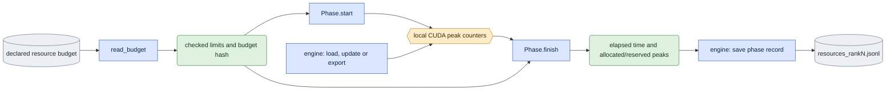

# `training/resources.py` — measure declared process resources

## Objective

Measure the CUDA allocated and reserved peaks in the process that does the
work. Bind the unchanged budget file to each phase.

- Sampled total-device memory is a separate external observation. It cannot
  replace these measurements.
- Outside the queue, ordinary runs can omit a budget. Queued children always
  use the same effective budget as the queue's supervision and notification
  contract.
- Native update acceptance requires complete local CUDA measurements.

## Data flow

1. Read the budget bytes once. Parse the two positive limits. Keep their path
   and SHA-256.
2. Before each phase, check those bytes again. Synchronize the local CUDA
   device and reset the Torch peak counters.
3. After the phase, synchronize again. Read the allocated and reserved peaks
   and the monotonic elapsed time.
4. Keep one record for each rank and phase, including a failed record when the
   execution or a limit check fails.

The engine or checker owns the publication of these records and the failure
evidence.

- An operation failure after a phase starts keeps a failed record. Before a
  fresh output exists, the trainer writes that record in its original queue
  log. It does not create a scientific output directory to report a startup
  failure.
- Budget validation, or a CPU refusal before a phase starts, is a preflight
  error with no allocator measurement.
- Neither route can publish a complete checkpoint.

At each checkpoint, the complete journal of each rank is copied into a fixed
`resource_snapshots/step_<step>/` record. Marker hashes identify these
snapshots, so later updates do not invalidate earlier checkpoint evidence.
Final verification also requires the snapshot records to equal the final live
journals.

This diagram shows one native CUDA phase. The engine orders `Phase.start`, the
work and `Phase.finish`. A failed finish still gives a failed measurement for
the engine to keep. It cannot certify completion. CPU runs record null peaks.

## Organization logic

### Reading a budget

`read_budget` reads the existing protocol's `wall_seconds_per_phase` and
`memory_limit_allocated_bytes`. It does not choose new limits or tolerances.

- It keeps optional tolerance data from the same parsed byte buffer. The
  experiment owner checks that data against its declared rule. A second read of
  the file name must not pair the tolerance of new bytes with an old budget
  hash.
- It keeps the optional `overall_seconds` only when present. The value must be
  a finite positive number, not a boolean. It is an overall queue deadline. A
  local phase never resets it or replaces it.

### Effective budget

- `default_budget` binds the declared 1,800-second phase limit and the
  48,000,000,000-byte allocated limit to canonical JSON bytes, with
  `path=null` and a reproducible content SHA.
- `effective_budget(path)` selects an unchanged explicit file record, or that
  default. It writes no file. `read_budget(None)` still returns null outside
  this explicit queue policy.
- `budget_environment` writes the checked effective record and its SHA into
  `ONESTEP_AVATAR_EFFECTIVE_BUDGET` and `ONESTEP_AVATAR_EFFECTIVE_BUDGET_SHA256`.
- `budget_from_environment` requires both fields, valid queue token and job
  bindings and an unchanged file or default identity. Partial, malformed or
  mismatched bindings fail before phase work.
- `Phase(..., budget=None)` uses only this bound queue budget. An explicit phase
  budget must equal any inherited queue budget. The start and the end of a
  phase check both the identity and the environment again. Events and saved
  measurements carry the effective SHA. No default applies to an unqueued CPU
  measurement.

### Phases

`Phase.start` and `Phase.finish` bracket the load, each update and each export.

- An allocated peak or an elapsed time above its limit fails the phase.
- Reserved peaks stay measurements. No threshold is invented for them.
- CPU runs record null CUDA peaks explicitly and cannot satisfy native
  acceptance.

The final validator requires every declared rank and phase exactly once, finite
nonnegative measurements, an unchanged budget and passed phase states. A missing
record, a changed budget, a duplicate rank or phase or a breached limit refuses
completion.

The queue's external wall-time supervisor of owned processes is still required.
A measurement of the elapsed time at a completed boundary cannot interrupt a
hung operation.

### Phase notifications

When a checked supervision contract exists, the module publishes a phase begin
(bound to the token, job, rank and budget) before the first synchronize, and a
phase end after the measurement. A notification failure fails the measurement
and keeps an original operation error. Without this contract, the hooks do
nothing.

The shared `execution/supervision.py` observer uses these events to time a phase
in progress. Its separate startup and transition guards cover the intervals
outside a local phase. The local `load` phase starts after the Accelerator
setup. A separate startup guard must cover process-group initialization. No
sampled total-device limit is relabeled as an allocated-byte limit.

`training_phases` gives the time-ordered notification list from the actual save
rule: load, the optional step-zero export, then each update followed by its
requested initial, periodic or final export. The queue freezes this order.
Checkpoint verification uses the same list through that checkpoint.

### Worked checks

- With an allocated limit of 48,000,000,000 bytes, a peak of 48,000,000,001
  fails, even if the sampled total-device memory was lower.
- A reserved peak above that number does not fail the allocated-memory rule by
  itself.
- A missing rank-three export record cannot certify a four-rank update.
- With a queued canonical default and a fake 100-second CUDA phase, the saved
  record and both notifications carry the default SHA. A measured peak of
  48,000,000,001 bytes fails under this default, even if the phase caller
  supplied null.
- A change of only the environment SHA, or a different explicit phase budget,
  refuses the work. A change of the budget bytes during a phase keeps a failed
  record with its original SHA.

## Invariants

- Use synchronized Torch counters on the actual local device, never
  `nvidia-smi`.
- Reset the counters once per phase. Allocations that are live at the reset
  are included.
- Keep the exact bytes and tolerances of the budget. Never rewrite old evidence.
- Missing, non-CUDA or failed records cannot publish native acceptance.
- This owner starts no process and imports no experiment code.

## Gotchas

- Torch counters exclude allocations outside its allocator. They measure the
  declared allocated quantity, not the total device occupancy.
- Synchronization adds diagnostic overhead.
- Phase checks add to external wall-time supervision. They do not replace it.

## Tests

- Controlled CUDA counters check the reset and synchronization order, the
  peaks, the elapsed time, exception preservation, exact limits and budget
  changes.
- The tests validate missing, duplicate and malformed rank and phase lists, and
  explicit CPU refusal.
- Effective-budget tests check the canonical default identity, optional overall
  validation, paired queue bindings, disagreement of explicit and default
  budgets, inherited phase events and the original no-budget behavior outside
  the queue.
