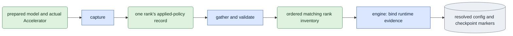

# `training/runtime.py` — record applied distributed precision

## Objective

Record the effective Accelerator and FSDP settings after setup, separately from
the requested YAML. Ordinary training and replay share the validation
calculation. Native acceptance requires the actual world size and agreement
across ranks.

## Data flow

1. The engine records the prepared model's FSDP policies and the storage dtypes
   of the adapter masters.
2. Each rank gives one JSON record through a fixed tensor collective. This
   avoids GPU object gathering.
3. The records are compared, except for their rank.
4. The complete ordered list is saved in the resolved config and the
   checkpoint markers.

The canonical launch owner checks the requested process count and precision.

This diagram shows actual setup evidence after model preparation. The inventory
contains policies and storage dtypes, not gradient or model-output measurements.

## Organization logic

Before the expensive sessions open, `check_accelerator` compares the actual
process count, mixed precision and selected distributed type with the declared
launch. Queued training requires FSDP. Serial replay requires ordinary
execution. A mismatch fails before the model and text load. This check does not
replace the later list of wrapped-module policies.

The capture records these items:

- world size, mixed precision and distributed type;
- conditioning precision and adapter storage dtypes;
- each distinct actual FSDP mixed-precision policy.

It uses the policies of the wrapped modules. It does not assume that the plugin
was applied. Typed float32 conditioning requires disabled root-input casting.
The parameter, reduction and buffer dtypes are kept as observed. No repair
changes them here. An empty policy list means that there is no FSDP module.
This separates an ordinary serial process from the original distributed
reference.

`validate` checks the complete rank list and the requested world and precision.
Native replay requires FSDP, fp32 adapter masters and the preserved float32
conditioning policy. A record without these facts fails. A serial reference
records its own ordinary policy and compares the relevant requested precision
separately.

Policy records prove the setup. They do not prove numerical equivalence or the
actual precision of consumer fields. Native acceptance also requires
observations inside the model consumer, including nested wrapping and
checkpoint recomputation. Setup records alone cannot replace that evidence.

Worked check: four rank records with bf16 parameter/reduction policy and
`cast_root_forward_inputs=false` agree. Changing only rank two's reduction dtype
or actual mixed precision fails. Copying a requested YAML into the runtime field
cannot replace the observed wrapped-module inventory.

## Invariants

- Rank count and process indices agree exactly with the launch.
- Adapter master storage and FSDP compute policy are separate facts.
- No model call, optimizer update or experiment import occurs here.
- Metadata validates applied setup; native gradient controls are E4 checks.

## Gotchas

FSDP policies may repeat on nested wrappers. Store their unique configurations.
Record a null dtype when a policy delegates precision to the original parameter.
An empty adapter inventory is not a verified fp32 adapter configuration.

## Tests

Exercise actual policy objects, disagreement across ranks, missing precision,
world/rank mismatch and old root-cast policies. CPU integration checks the normal
trainer's publication and marker binding; it does not prove native FSDP.

## Deterministic training policy

The small shared owner `training/numerics.py` declares one required child
environment: `CUBLAS_WORKSPACE_CONFIG=:4096:8`. It applies these settings:

- strict Torch deterministic algorithms, with `warn_only=False`;
- cuDNN deterministic mode, and cuDNN benchmarking disabled;
- CUDA matmul TF32 disabled.

These are the settings of the successful one-rank control. That control does
not change the separate TF32 setting of cuDNN. Observe it explicitly and
require serial and native agreement. Do not change it silently. This policy
changes only the numerical kernel selection. It changes no training input,
seed, sigma, budget, optimizer or tolerance.

The queue records the exact required environment in a version-two training
launch record and passes it to the guarded child. The typed engine compares the
inherited setting with that record before it applies the policy.

- A direct typed run without a queue configures the workspace before native
  imports.
- A late workspace configuration after CUDA initialization is refused. Native
  backend detection can start CUDA before training. The flags can be applied
  after that detection only when the required workspace was already inherited
  correctly.
- The policy applies before reserved CUDA buffers, the Accelerator, prompt or
  model sessions and cuBLAS work.

Runtime capture produces schema version two with observed numerical flags on
every rank. `validate` accepts only schema two: it checks exact field types, full
rank agreement and, when the caller requests it, the required numerical policy.
Missing flags are never filled from current defaults.

Public serial replay requires the original native record to declare the
supported policy. Its supervised launch carries the original required
workspace. Apply the shared policy before Accelerator/CUDA, capture the serial
runtime after preparation and compare every numerical flag with the original
native ranks. Save the serial observation in the replay protocol/result and
recheck the applied policy before update, export and publication. The native
four-rank reference and its serial replay must use the same current source
profile.

CPU controls cover real Torch flag setters/readers, strict warning mode,
environment binding and late-application refusal; refusal of a schema-one launch
or runtime record; missing, malformed or differing rank observations; engine failure
before model loading for a wrong inherited workspace; and replay refusal of an
undeclared or different original policy. Numerical acceptance additionally requires
the actual four-rank updates and fixed serial comparisons (E4). These checks do not
establish preview/product or learned video quality.
