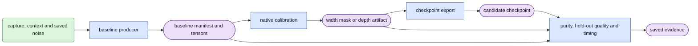

# Whole-clip pruning architecture

## Objective and scope

This package selects and exports smaller LTX transformer structures.
Its native task is one full-clip bidirectional D0 forward at each exact `[sigma,0]` schedule.
Capture frame zero is a clean condition. Later frames are generated.
There is no generated history, cache or sliding window.
Learned-head training has an explicit input option: continuous F18 temporal crops from verified full sources.
`data.training_windows` owns that option. Calibration and evaluation keep the full-source contract.

Read the [algorithm](core_algorithm.md), [verification gates](VALIDATION.md)
and [run guide](usage.md) after this page.

## Source owners

| Area | Responsibility |
|---|---|
| `core/` | Checkpoint registry, VAE scales, model lifetime, private upstream access and provenance |
| `data/` | Text context cache, saved inputs, paired identities and actor identities |
| `score/` | Activation observations, scores, masks, width/depth export and bounded local fitting |
| `evaluate/` | Baseline production, saved comparison, decoding, pixel metrics and timing |
| `checks/` | In-memory intervention versus exported checkpoint parity |

`evaluate.whole_clip_baseline` is the only saved rollout producer.
`data.whole_clip` is the shared native-input validator and reconstructor.
`core.session` owns BF16 model lifetime and prompt context, but no schedule.
Callers own their exact schedules and view selection.

## Dependency rules

- Keep private upstream attribute access in `core.ltx_adapter`.
- Use public avatar `corpus.dataset` readers and `model.common`, `model.causal`, `model.sampling` and `model.backbone`.
- Prune does not import avatar training, execution or experiment modules.
- Avatar consumers can import shared prune registry, session, prompt and media utilities.
- Candidate verification imports score/export validators lazily from `data.whole_clip`.
  Hooks themselves use the saved-input contract. Keep this deferred edge to avoid an import cycle.
- Report code under `expr/` reads saved artifacts for sections, captions, plots and validation.
  It cannot load models, decode latents, start queue jobs or recreate missing scientific results.
  Follow the [report and wording contract](reporting.md).

The avatar queue owns its `prune_baseline` experiment wrapper.
That wrapper calls the prune producer directly and saves its original manifest under `baseline/`.
It adds component/software pins and saved-completion records at the job root.
Prune does not acquire a second queue or supervisor.

## Artifact flow

Shapes and colors follow the [shared legend](core_algorithm.md#diagram-legend).
The figure shows ownership, not numerical acceptance.

## Width, depth and fitted weights

Width masks use `whole_clip_d0_mask_v1`.
They remove attention heads or FFN channels at executed projection boundaries.
`compact_faithful` compresses stored parameters and restores original execution widths.
`compact` changes supported executed widths and needs its own BF16 parity result.

Depth artifacts use `whole_clip_d0_depth_v1`.
They keep complete blocks in original order and map them to contiguous new indices.
The CPU exporter streams payload bytes and checks exact parameter accounting.

`ffn_reconstruction` supplies local CPU ridge fitting and cache validation.
It does not supply a native collector or fitted-checkpoint exporter.
Changed fitted weights require a new reference intervention.

## Worked ownership check

A changed capture file fails its full hash before reconstruction.
A changed calibration manifest invalidates the mask or depth artifact.
A changed export architecture fails candidate verification.
Passing those checks still requires a numerical export-parity run.

The [module index](README.md) describes every current production owner.

## MobileWan dataset statistics

`data.head_score_dataset` owns complete membership audit and deterministic held-out case selection.
`score.mobilewan_heads` owns squared projected energy, actor-cluster statistics and nested global allocation.
These owners do not load the transformer or publish a completed experiment.
The dataset runner must use shared native inputs and model lifetime, and freeze train masks before held-out inspection.

`score.mobilewan_records` owns atomic view records and strict resume identities.
The rollout producer supports explicit direct dev and capture-only D0 through its existing shared rollout.
The restricted queue wrapper accepts unmodified direct dev D0 at sigma <=0.95.

`score.mobilewan_aggregate` owns complete coverage checks, train-only mask freezing and final cohort statistics.
It reads saved worker records and never opens a GPU model.
Final statistics retain original head indices and exact pooled/per-sigma conditions.

## Learned head recovery

`learn/` owns scalar pruning gates, FP32 adapters, official velocity loss and bounded phase execution.
`data.learned_head_study` owns actor splits, paired draws and the frozen input authority.
`data.foreground` calls public corpus crop and mask owners; it does not infer semantic keypoint indices.
`learn.teacher_references` is the only producer of shared original-teacher evidence.
`core.ltx_adapter.velocity_forward` accesses the supported X0 wrapper's underlying velocity model once.

Learning imports core, data and score boundaries. It does not import avatar training or execution.
Recovered export calls existing coupled structural surgery and merges only compact V/output adapters.
Recovered validation enters `data.whole_clip.verify_candidate` through a deferred checks import.
Frozen evaluation can import learning's numerical and input helpers; it performs no optimization.
`learn.step` registers native prediction and hook-owned gates inside one trainable module.
`learn.ddp` replicates the complete backbone and averages gradients once through DDP.
`learn.protocol` binds batch size, rank draw assignment and checkpoint cursor semantics.
`learn.wandb_logger` reads saved receipts on CPU and owns rank charts and global metric means.
The new learned evaluator produces versioned paired evidence separate from ordinary baseline rollouts.

The `width_recovered` family uses `whole_clip_d0_learned_heads_v1`.
Its envelope pins original IDs, both geometry wrappers, components, training state, consumed noise and merged tensors.
Stored compact widths preserve full original Q/K normalization and RoPE identities.
Native structural, transfer, fusion and merged-reload checks remain separate from decoded quality.
