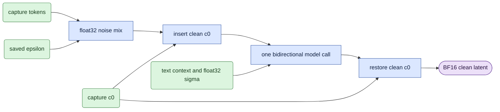

# Whole-clip pruning algorithm

## Terms and shapes

- **D0** noises capture latents and predicts clean capture latents.
- **D1** noises guide latents. It is an optional producer arm, not the pruning calibration task.
- **c0** is the clean capture's first latent frame.
- **epsilon** is the saved random noise tensor.
- **sigma** is the starting noise level for one direct denoising step.
- **Functional mask** zeros a head or FFN channel at its output-projection input.
- **Export parity** compares that intervention with its saved checkpoint execution.
- **Held-out actor** is an actor excluded from calibration across clips, Parts and views.

Dense video latents have shape `[1,C,F,H,W]`.
With patch size one, tokens have shape `[1,F*H*W,C]`.
A frame occupies `H*W` consecutive tokens.
Token `(f,h,w)` has index `(f*H+h)*W+w`.

Use registered VAE scales. The aligned pixel count is `time*(F-1)+1`.
Preserve the recorded fps and source coordinates.

## Input reconstruction

1. Validate the saved native D0 manifest and requested view/sigma row.
2. Check capture, VAE, epsilon and context identities.
3. Build the same grid from capture shape, fps and registered scales.
4. Mix source and noise in float32:
   `x_sigma=(1-sigma)*capture+sigma*epsilon`.
   Cast the result to BF16.
5. Replace the first `H*W` tokens with `c0`.
6. Set those tokens' timesteps to zero. Keep other token timesteps at sigma.
7. Use float32 global sigma and float32 token timesteps.
8. Set `attention_mask=None` for full bidirectional visibility.
9. Run the complete clip as one block with no cache.
10. Restore exact `c0` in the predicted clean output.

BF16 applies to weights, latents and ordinary context.
It does not mean a BF16 schedule.
The session's transformer wrapper returns clean predictions; do not convert them as velocity a second time.

## Worked calculation

Let `F=3`, `H=W=2`, and `C=128`.
There are 12 tokens. Tokens `[0,4)` contain the clean first frame.
The block plan is `[(0,3)]`.

For a later scalar source 2, epsilon 6 and sigma 0.5, the model input is 4.
For a first-frame scalar source 2, replace that mix with 2 and set its token timestep to zero.
The global sigma remains 0.5.

At sigma 1, capture and guide have zero weight in the noise mix.
With identical epsilon, context and c0, D0 and D1 have identical model inputs.
Equal inputs are a useful control; verify saved outputs within the same numerical policy.

## Calibration and interventions

For each calibration view/sigma, reproduce the saved baseline before accepting scores.
The scorer rejects nonfinite maximum differences and differences above 0.02.
It samples generated-frame tokens and observes activations before output projections.

The default proxy is sampled activation RMS multiplied by the corresponding projection norm.
Average squared activation means equally across calibration cases before taking RMS.
Remove low scores independently in each branch, with stable ties and one retained unit minimum.

Head masks multiply a complete head's channels before `to_out[0]`.
FFN masks multiply post-activation channels before `ff.net[2]`.
Checkpoint export must preserve coupled projections, normalization and positional identity.
Depth parity instead uses an ordered retained block list.

## Metrics and their limits

Quality metrics exclude clean latent frame zero.
The direction is `d=(x_sigma-predicted_x0)/sigma`.
Relative L2 is `norm(d_candidate-d_baseline)/norm(d_baseline)`.
Cosine compares direction angle. Capture MSE compares predicted and capture latents.
These metrics do not prove identity, motion correctness or decoded quality.

Export parity uses maximum absolute latent difference, with default tolerance 0.02.
A passing result proves agreement with the declared intervention, not agreement with the unpruned teacher.

Timing uses warmed, synchronized transformer calls.
Speedup is `baseline_ms/candidate_ms`.
ABA/BAB orders repeat the outside arm to expose drift.
Storage size and parameter counts require their own denominators.

## Diagram legend

Use a left-to-right flow.
Rounded input nodes hold tensors, rectangular nodes hold operations, and output nodes hold saved artifacts.
Use green for tensors, blue for operations and purple for outputs.
This follows the [avatar legend](../../onestep_avatar/doc/core_algorithm.md#7-end-to-end-data-flow).
Diagrams explain data flow. Saved hashes and numerical checks establish evidence.

## MobileWan squared projected energy

The optional `mobilewan_heads` helper uses executed gated head vectors and head-local projection Gram matrices.
It computes mean squared projected vector norm over declared generated tokens.
Average raw energies over sigmas and equal-weight views before dividing by the cohort block mean.
Actor-cluster bootstrap draws retain all views and sigmas, and recompute normalization in each replicate.
Global allocation uses ascending pooled train scores, original block/head ties and one retained head per block.
This helper supplies no native execution evidence yet.

## Learned FFN binary masks

Each original video FFN channel has one FP32 score.
Stable descending score order selects each block's declared retained count.
Equal scores keep lower original channel IDs. The preset retains 14,848 of 16,384 channels.
The count ramps in multiples of 128 after 50 dense updates and reaches its final value at update 300.
Multiply post-GELU activations by `binary_mask + (sigmoid(score) - stopgrad(sigmoid(score)))`.
The grouped subtraction keeps the forward exactly binary.
Keep one decision per update and a fresh surrogate graph per forward.
There is no FFN sparsity term; the exact count already defines the budget.
Freeze original IDs after update 1000, then train adapters for 300 further updates.
The joint arm uses existing head sigmoid learning and legal binary refinement alongside these FFN masks.
The [training design](learn/ffn_training.md) owns state and numerical details.

## Learned head velocity path

Use native velocity from `core.ltx_adapter.velocity_forward` for learning.
The helper calls the velocity model once and applies the stock timestep-based clean conversion.
Do not divide rounded clean outputs by sigma to form the training prediction.
The target is saved `epsilon.float() - capture.float()`.
Reduce squared error over generated tokens and channels in FP32; c0 has no loss weight.
The unchanged teacher remains an evaluation reference, rather than the loss target.

Every logit starts at +3. Soft gates use sigmoid with temperature one.
The first 700 updates add the frozen sparsity penalty and its configured coefficient ramp.
The current ten-level GT preset uses mean `relu(alpha+3)` and `lambda(t)=0.01*(0.1+0.9*min(t/100,1))`.
The effective coefficient is 0.00109 at update one and 0.01 from update 100. Gate LR is constant 0.01.
Earlier presets retain their declared zero-start, 300-update ramp for reproduction.
The sparsity derivative is zero at or below alpha minus three. This stops pressure, without clamping the optimizer state.
The older eight-level preset also supports mean-sigmoid sparsity for exact reproduction.
The next 300 updates use an exact legal binary forward and a sigmoid straight-through gradient.
An exact block/count dynamic program selects retained original heads.
A fixed decision serves all draws and backward recomputation within an update.
Full-replica DDP uses one complete local loss per rank and one averaged gradient update.
Four ranks consume four independently scheduled F18 windows. No second gradient reduction occurs.
Legacy serial/FSDP two-draw studies retain their declared accumulation semantics.

At update 1,000, freeze the binary IDs and transfer adapters at their frozen rank and Adam moments by channel identity.
The compact network then receives 500 adapter updates, with retained pruning amplitudes one.
The soft-only arm hardens after 1,000 soft updates.
Energy and random arms use a matched 300-update removal ramp and the same adapter budget.
Fresh recovery discards selection adapters and moments, then initializes full-source adapters before slicing.

Recovered outputs use the `width_recovered` family.
Their versioned envelope binds full study and component identities, original head IDs, all consumed draws and merged tensor contents.

## Uniform F18 optimizer inputs

Use every latent in F18 sources and one uniform continuous 18-latent span in longer sources.
For F28 sources, start positions zero through ten are legal and equally selectable.
Select the start using a separate RNG keyed by the draw noise seed. Preserve optimizer RNG state.
Slice capture and saved epsilon at the same bounds. Rebuild window-local positions and first-keyframe marks.
The window's first latent is clean c0; only its remaining 17 latents enter velocity MSE.
The aligned decoder output is 137 frames at the original spatial geometry and fps.
This is a slice of continuous VAE latents, not an independent re-encode of a raw RGB crop.
Full-source calibration, export parity and quality evaluation retain the original input contract.
Store both full source/noise file pins and actual consumed window tensor hashes.

## Progressive gate removal

The progressive alternative uses 500 soft updates and no binary or compact phase.
At the configured interval, filter by positive decrease and regret, then rank globally by regret and decreasing logit decrease.
Remove up to the rounded-up fraction of the original head count; leave every other free gate soft.
Free gates retain sigmoid gradients and free-logit sparsity with denominator 1,536. Terminal heads have no logit update.
The [policy design](learn/progressive.md) defines trajectory statistics, deterministic global selection and exact resume.
