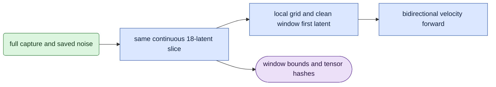

# data/training_windows

## Objective

Build continuous F18 inputs for learned-head training when `uniform_f18=true` is frozen in the study.
F18 means 18 latent frames. Keep all 18 frames of an F18 source. Choose one 18-frame span in a longer source.

## Data flow

`whole_clip` first verifies and saves the full capture and noise. `heads.training_input_case` calls this owner only for optimizer inputs.
Slice capture and epsilon at the same frame boundaries. Rebuild an F18 grid with local positions and keyframe marks.
Mix capture and noise in FP32, cast to BF16 and insert the window's first latent as clean conditioning.
Keep global sigma and token timesteps in FP32. The model sees one bidirectional block and no cache.

The original input manifest describes the full source bundle. It is not changed to claim the crop is a whole source clip.
Each consumed training draw adds a `training_window` record with the bounds, seed, coordinate policy and actual capture/noise tensor hashes.
Validation, calibration, export parity and monitoring continue to call the full-clip input owner.

## Organization logic

`enabled` checks the optional boolean. The absent option is false.
`bounds` uses a separate RNG seeded by `uniform_f18:<noise_seed>` and chooses uniformly from zero through `source_frames-18`, inclusive.
This preserves the optimizer RNG state and makes duplicate ranks, paired arms and resumed draws agree.
`crop_case` slices aligned tokens and builds local geometry. It intentionally treats a nonzero source frame as a new first keyframe.
`slice_regions` applies the same token range to full-source person, face and hand weights.
`validate_saved_window` reconstructs capture and noise slices on CPU from the pinned full-source bundle.
Resume and recovered-candidate validation reject changed bounds, seed, source content or cropped tensor hashes.

Worked example: an F28 source has eleven legal start positions, zero through ten.
A draw starting at five uses source latents `[5,23)`. Source latent five is clean c0; source latents six through 22 receive noise.
The new temporal positions start at zero. Spatial crop, fps, weights and text context stay the same.

## Invariants

Every enabled training input has exactly 18 continuous latents. Sources shorter than 18 fail; they are never padded or looped.
Capture, epsilon and regional weights use the same half-open frame range.
The first latent of the selected window is exact clean conditioning and is excluded from velocity MSE.
F18 input tensors, positions and masks remain bit-identical to the full-source path.
The frozen config and checkpoint identity bind the option. Enabling it requires a new study.

## Gotchas

This is a training-only crop. A long full-clip validation or calibration input can still need more memory.
Window-local first-keyframe semantics are intentional; they differ from the original continuous VAE time bounds at a nonzero start.
Do not use this owner to label a cropped input as a full-clip native calibration artifact.
The saved full epsilon file hash and cropped epsilon tensor hash identify different things. Both remain in the draw receipt.

## Tests

`test_training_windows.py` checks F18 identity, F28 and longer spans, nonzero conditioning, RNG replay, region alignment and changed saved evidence.
Native forward/backward checks use the same cropped input path separately from the default F18 memory test.
