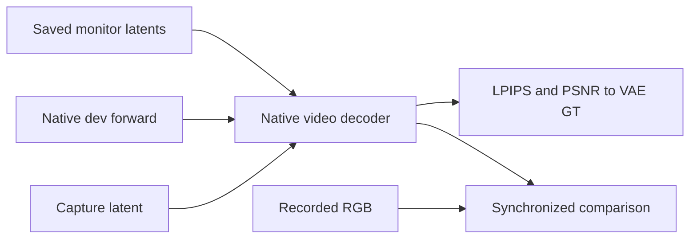

# Pinned learned-head checkpoint media

## Objective

Decode and compare the saved monitor predictions of a live learned-head study at each 100-update checkpoint.
The file is a Python template with the `.py.txt` suffix. It is not in the frozen training source inventory.
A live study therefore keeps its code identity. Each receipt records the exact template bytes.
It never trains, never writes into the training folders and never changes training files.

## Usage

Started by: a direct human or agent command on one free physical GPU outside the training ranks.
Run from `LTX-2` in conda environment `ltx`. The template waits until the physical GPU has less than 1 GiB used.

Run the `reference` stage once, after the first saved monitor (update 100):

```bash
RUN=../expr/refiner_prune/2.5/<study>
CUDA_VISIBLE_DEVICES=5 CUBLAS_WORKSPACE_CONFIG=:4096:8 PYTHONPATH="$PWD" \
python -u scripts/prune/evaluate/learned_head_checkpoint_media.py.txt \
  --study $RUN/configs/frozen_study.json --stage reference --update 100 --output $RUN/partial
```

Run the `media` stage for each saved monitor checkpoint `N` (100, 200, ...):

```bash
CUDA_VISIBLE_DEVICES=5 CUBLAS_WORKSPACE_CONFIG=:4096:8 PYTHONPATH="$PWD" \
python -u scripts/prune/evaluate/learned_head_checkpoint_media.py.txt \
  --study $RUN/configs/frozen_study.json --stage media --update N --output $RUN/partial
```

`--update` is the replay checkpoint for `reference` and the rendered checkpoint for `media`.
`--output` must be inside the study root. Outputs:

- `reference/reference.json`: native dev predictions, the replay control, decoded GT references and native scores.
- `reference/media/actor_<id>/`: GT RGB/VAE MP4s, the preserved source RGB and 320-pixel panel caches.
- `update_NNNN/media.json`: per-case decoded scores and links for checkpoint `N`.
- `update_NNNN/media/actor_<id>/sigma_<sigma>/`: `comparison.mp4`, `poster.png`, `rendering.json` and full-size state MP4s.

Run the `steps` stage for the report videos. One process loads the model once for all listed
checkpoints and actors; split actors across free GPUs:

```bash
CUDA_VISIBLE_DEVICES=4 CUBLAS_WORKSPACE_CONFIG=:4096:8 PYTHONPATH="$PWD" \
python -u scripts/prune/evaluate/learned_head_checkpoint_media.py.txt \
  --study $RUN/configs/frozen_study.json --stage steps --updates 500 --actors 35 84 --output $RUN/partial
```

It writes `reference/steps/actor_<id>/` (cached native predictions, videos and scores) and
`update_NNNN/steps_v2/actor_<id>.json` with `update_NNNN/steps_v2/actor_<id>/sigma_<sigma>/steps_<n>/` comparisons.

See the [run guide](../usage.md#learned-head-checkpoint-media).

## Data flow



The `reference` stage rebuilds the fixed monitor inputs under `<output>/reference`, with seed 2042.
It requires bit-identical noise to the saved training input and an equal input manifest hash.
It runs one native dev forward per actor and sigma: gates all one, adapters disabled, one direct `[sigma, 0]` call.
It then loads the replay checkpoint and repeats one soft monitor prediction on one rank.
The replay must match the saved four-rank monitor within 0.02 absolute.
The transformer is released before the decoder loads.

The `media` stage reads `monitor_NNNN.json` and checks every named tensor hash.
It decodes the soft (`trained`), hardened and previous-checkpoint soft predictions with decoder seed 42.
It decodes the capture latent once per actor as VAE GT.

## Step videos

The `steps` stage predicts native dev, soft and hard for three cases:

- σ 0.9098098278045654 with one direct call `[σ, 0]`.
- σ 0.9098098278045654 with four Euler steps: `[0.9098, 0.8537, 0.7364, 0.4802, 0]`.
- σ 0.9403364062309265 with eight Euler steps: `[0.9403, 0.9098, 0.8845, 0.8356, 0.7924, 0.7017, 0.5531, 0.3875, 0]`.

Step levels are evenly spaced indices of the official 30-step dev grid, keeping the start and zero;
receipts record the exact values. Each Euler step blends the denoised prediction with clean c0, as the
stock `post_process_latent` does, then applies `EulerDiffusionStep` in FP32.
Hard uses the checkpoint's legal mask, checked against the logits. In the binary phase the trained state is hard.
Two controls must pass, each within 0.02: a one-step prediction of the trained state at σ 0.9489720463752747
against the saved training monitor, and the Euler sampler with `[σ, 0]` against the direct call.
Each comparison has four panels in two columns: Capture VAE, native dev, soft gates and hard gates.
Predictions are cached under `steps/`; media and receipts go to `update_NNNN/steps_v2/`.

`load_frozen` accepts only the declared phase-budget code drift (`ALLOWED_CODE_DRIFT`) for a study frozen
before that change, and records the drift in each receipt. Any other code change fails.

## Organization logic

Each comparison has six panels in two rows by three columns:
Capture RGB, Capture VAE and Native dev; then soft gates at step `N-100`, soft gates and hard gates at step `N`.
The step-`N-100` panel at update 100 is an explicit missing panel.
All panels share every source frame and the 30 fps playback rate. Panels are 320 pixels square with padding.

Scores compare each decoded state with decoded VAE GT, excluding RGB frame zero:

- `frame_psnr`: full-frame pixel MSE and PSNR.
- `frame_lpips`: pinned AlexNet LPIPS on the whole frame, resized to 256 pixels.
- `person_lpips`: the same metric on the GT person box, with a white matte outside the person.

The template keeps its own GT-box LPIPS copy. It clamps resized crops to [0, 1], because antialiased
resizing can leave values a few ULP outside the range that the pinned metric accepts.

The reference also scores VAE GT against recorded RGB. This is the VAE reconstruction ceiling.

## Invariants

- Do not modify the training config, code, checkpoints, draws or numerical policy.
- Use the frozen four validation actors, one view each, the frozen monitor sigmas and seed 2042.
- Native and checkpoint predictions share saved input manifests and exact noise.
- Receipts are atomic. A completed receipt is never replaced; a rerun skips it.
- Report code reads these receipts and media. It cannot call this template.

## Gotchas

Hardening here is the monitor's immediate legal mask, not compact export parity or binary-refinement quality.
Small soft gate values do not remove stored weights.
LPIPS and PSNR against VAE GT measure distance from the decoded capture, not identity or action correctness.
The panel has four actors and one noise seed. It is monitoring evidence, not the final quality result.
Each decode of a 217-frame clip runs without tiling. Use a whole free 48-GiB GPU.

## Tests

Check the frozen code identity before and after execution.
Check exact noise, equal input manifests, the replay control and clean-frame equality.
Validate the full-length videos, synchronized frame maps and saved hashes in each rendering record.
