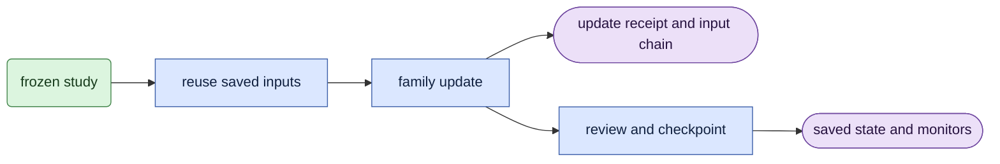

# learn/ddp_owner

## Objective

Run native acceptance and DDP mask training for every learned head/FFN family with one owner.
The FFN (`learn.ffn`), joint selection (`learn.joint`) and fixed compact recovery (`learn.compact`) families supply small hook sets.
The [glossary](../glossary.md) defines DDP, receipts and frozen studies.
This module supplies the runtime, input reuse, monitors, exact-resume acceptance, consumed-input checks and the update loop.

## Data flow

1. `run` sets the deterministic numerical policy, loads the frozen study and opens the frozen session.
   Only rank zero hashes the pinned inputs and components; runtime initialization precedes session opening.
2. `Runtime` checks the exact physical device list and rank count, starts one NCCL group (15-minute timeout), then votes on initial free capacity before loading any model.
3. `native` runs the bounded acceptance: all-one parity, a checkpointed backward, exact resume and fixed-mask recovery.
4. `train` resumes from the latest canonical checkpoint, or saves update zero and its monitor.
5. Each update consumes `world_size` frozen draws. A testing pilot consumes the first testing-rank draws of each formal draw group.
6. Rank zero publishes one immutable update receipt; all ranks join the stop, checkpoint and monitor decisions.
7. At each visualization interval, rank zero decodes the actual training draw through the shared [preview owner](../../learn/visualization.py).

## Organization logic

A family module exposes these names:

- `state`: the numerical owner (`JointStep`, `optimizers`, `update`, `state`, `save`, `read`, `restore`).
- `label` and `script`: the log label and the provenance script name.
- `native_fixture`, `native_prepare`, `native_first_checks`, `native_freeze`: the acceptance variations.
- `check_start`: preconditions before training, for example V3 prerequisites and pending reviews.
- `after_update`, `receipt_fields`, `reviews`, `checkpoint_due`, `after_checkpoint`, `monitor_due`, `final_update`: the loop variations.

The update order is fixed: forward/backward/step, family records, receipt, stop vote, reviews, checkpoint, family tail, preview, monitor, final-update check.
Checkpoints occur every `checkpoint_interval` updates, when `checkpoint_due` is true, or when a stop is requested.
The [run guide](../usage.md#training-visualization) owns preview settings.
The captured x0 uses the weights before the optimizer update; decoding adds no transformer forward.

`verify_consumed` rebuilds the input chain from the receipts and must equal the checkpoint's chain.
Each rank checks a disjoint share of the consumed inputs; a failure on any rank stops all ranks.
Missing files, malformed receipts and chain mismatches join the same failure vote before any rank raises.

Worked example: four ranks resume at update 1,700 with 6,800 consumed draws.
Each rank checks 1,700 draws. Each saved epsilon is hashed once and each shared capture once.

## Invariants

- Use the exact frozen device list, software and components.
- Keep the backbone frozen; a changed parameter version fails the update.
- Keep `draw_cursor`, the input chain and complete rank RNG in every checkpoint.
- A replayed update receipt must equal the saved one in every field except memory and seconds.
- Monitors restore RNG, gate state and train mode on success or failure.

## Gotchas

Acceptance and training load separate resident models. This keeps acceptance state out of training.
The pilot stride is the frozen `world_size`, not the pilot rank count.
`receipt_fields` must include `phase` and `ffn`; the log line reads them.
Hard links reuse the parent study's saved inputs; the input owner still validates their hashes.

`memory` empties the CUDA cache before reading free device memory.
Otherwise dead blocks reserved after a no-grad full-source forward count as occupied memory.
Each rank checks the gathered rows against `headroom_bytes`; any failure stops all ranks.

## Tests

`tests/test_ddp_owner_families.py` checks family hook sets and the family boundaries on CPU.
`tests/test_ddp_owner_families.py::test_memory_releases_cache_before_reading_free_memory` pins the cache release order.
`tests/test_ddp_owner_loop.py` runs both numerical families through three updates and a serialized one-plus-two resume on four CPU ranks.
It compares complete state hashes, scientific receipt digests, input chains and draw order.
It enables previews every two updates and checks exact resume after the preview writer consumes Torch RNG.

The fixture pins CPU gradient summation to rank order because Gloo bucket rebuilds can change floating-point reduction order.
Separate gradient tests exercise the stock DDP reducer against serial accumulation.
The loop fixture does not establish bit-identical process-restart behavior for native NCCL.

Missing input and missing receipt controls verify that every rank exits its failure vote.
`tests/test_ffn_learning.py` and `tests/test_readmission.py` check the numerical state owners with four CPU ranks.
The [native acceptance guide](../VALIDATION.md#learned-native-acceptance) defines matched disposable and formal-rank checks.
