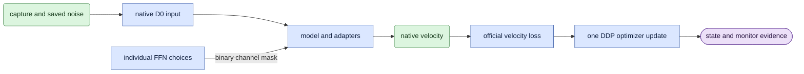

# learn/ffn

## Objective

Run bounded native acceptance and formal DDP training for learned head and FFN masks.

## Usage

A human or agent runs this standalone CLI from `LTX-2` in `ltx`.
Check `nvidia-smi` before each launch. No avatar queue is involved.

```bash
CUDA_VISIBLE_DEVICES=4,5,6 CUBLAS_WORKSPACE_CONFIG=:4096:8 conda run --no-capture-output -n ltx torchrun --standalone --nproc_per_node=3 -m scripts.prune.learn.ffn --study ../expr/refiner_prune/2.5/learned_ffn_joint_20261018/configs/frozen_study.json --phase native --testing
```

After the test checks pass, formal execution uses four ranks:

```bash
CUDA_VISIBLE_DEVICES=0,1,2,3 CUBLAS_WORKSPACE_CONFIG=:4096:8 conda run --no-capture-output -n ltx torchrun --standalone --nproc_per_node=4 -m scripts.prune.learn.ffn --study ../expr/refiner_prune/2.5/learned_ffn_joint_20261018/configs/frozen_study.json --phase formal
```

`--phase formal` runs fresh four-rank acceptance before formal training.
`--phase train` resumes from the latest canonical checkpoint and requires that acceptance.
`--max-updates` bounds a smoke run; its endpoint does not mark the full experiment complete.
`--testing` accepts only the native phase and exact physical GPUs 4–6.
Outputs include checkpoints, per-update receipts, full-source monitor tensors, acceptance and mutable status.
See the [run guide](../usage.md#learned-ffn-masks).

## Data flow

The frozen study supplies components, context, sources and draws.
The shared input owner creates native D0 cases. Optimizer cases use the existing F18 crop owner.
The runtime wraps `JointStep` in DDP and publishes one global receipt per completed update.
Monitoring uses complete saved sources at three exact sigmas.



## Organization logic

Native acceptance compares original velocity with all-one gates and zero adapters bit for bit.
A disposable two-update selection exercises both mask families, exact serialized resume and fixed-mask recovery.
Source assignments exercise native F18 and nonzero F18 crops from F28 sources.
An additional full-source call checks inference memory and clean-frame equality.
Three-rank test evidence cannot qualify the formal four-rank run.

Formal selection ends at update 1000. Adapter recovery ends at update 1300.
Each update consumes four distinct draws. Checkpoints occur every 50 updates and at phase boundaries.
Monitoring preserves RNG and gate state on success or failure.
Input-chain validation checks every consumed manifest, epsilon and crop on resume.
Per-update replay compares scientific fields while retaining original timing and memory observations.

## Invariants

Honor exact physical device lists and frozen software. Keep at least two GiB of device headroom.
Keep pretrained weights unchanged. Save complete rank RNG and `draw_cursor = world_size * update`.
SIGTERM requests a checkpoint after the current global update; it does not restart a stopped study.
The CPU logger reads receipts through `learn.ffn_logger` and opens no model.

## Gotchas

Hard links reuse original saved epsilon bytes without retaining an old directory dependency.
The shared input owner still validates hashes and settings after reuse.
Formal acceptance and training load separate resident models.
A valid mask and successful training do not qualify compact execution or decoded quality.

## Tests

Run `test_ffn_learning.py`, the prune CPU suite and Ruff before native tests.
Native receipts identify the study, ranks, exact replay, gradients, source lengths and measured memory.
