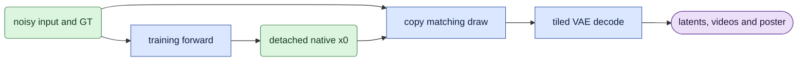

# learn/visualization

## Objective

Show the actual noisy input, ground-truth (GT) latent and predicted clean latent (x0) during pruning training.
The head, FFN and joint learners share this owner.

## Data flow

1. `arm` selects positive optimizer updates divisible by `visualization_interval`.
2. Rank zero copies the first forward's native x0 prediction to the CPU, without its autograd graph.
3. `snapshot` copies that draw's noisy input and GT, restores exact clean frame zero and converts tokens to dense latents.
4. `save` decodes all three latents with the session's pinned VAE after the optimizer update.
5. All ranks join the failure vote before the next training operation.

## Organization logic

The frozen training config accepts `visualization_interval`, a nonnegative integer with default `100`.
Zero disables previews. The interval counts optimizer updates, including resumed update numbers, rather than microbatches.
For example, interval 100 saves updates 100, 200 and 300. It does not save update zero.
An interval of 25 saves updates 25, 50 and 75.

The network prediction comes from the native training forward before that update changes the weights.
It is the stock timestep-based x0 conversion. No extra transformer forward runs.
The first draw on rank zero supplies every panel, including during accumulated head training.

The output directory contains `noisy`, `gt` and `predicted_x0` latents (`.pt`) and full-resolution videos (`.mp4`).
`comparison.mp4` places those three roles left to right at equal displayed height, with aspect-preserving padding.
Each panel says `VAE decode`. The combined video uses the original fps and the complete local decoded window.
`poster.png` shows the middle frame. `rendering.json` records sample settings, window bounds, input hashes, tiling, layout and artifact hashes.
The comparison uses 320-pixel square cells and titles readable at its recorded 480-pixel viewing width.
Replayed completed previews verify the sample, latent tensors and media hashes without decoding again.
This keeps their original tiling when available device memory changes.

The head learner writes under its arm's `visualizations/update_NNNN/` directory.
The shared FFN/joint owner writes under `training/visualizations/update_NNNN/`.
See the [run guide](../usage.md#training-visualization) for these paths.

## Invariants

- Preserve the noisy input, GT, crop, sigma, fps and clean first latent from the selected training draw.
- Copy only detached tensors to the CPU. Do not retain an autograd graph or change gradients.
- Use the selected session's VAE and BF16 decode dtype.
- Restore Python, NumPy, CPU Torch and the current CUDA device's RNG on success or failure.
- Keep visualization attributes out of model parameters, buffers and optimizer checkpoints.
- Only rank zero loads the decoder or writes media. Other ranks wait in the shared failure vote.

## Gotchas

The transformer remains resident. The official `tiling_config_for_vae` selects tiles from the checkpoint geometry and available device memory.
The selector runs before VAE loading and accounts for its weights, required overlap and activation budget.
The VAE weights still need additional device memory. The decoder unloads after each preview.
Previews add decoding time and are training diagnostics. They do not replace held-out quality evaluation with its recorded decoder policy.
For cropped inputs, frame numbers describe the local decoded window. They are not a claim of exact original RGB frame alignment.
A decoder or media failure stops every rank after RNG restoration.
Changing this config requires a newly frozen study; code maintenance does not restart an existing study.

## Tests

`test_training_visualization.py` checks the default cadence, disabling, custom intervals and rank selection.
It compares exact losses and gradients with previews enabled and disabled for all three forward owners.
It checks paired latent geometry, clean frame zero, first-draw selection and detached CPU tensors.
A deterministic decoder fixture exercises real MP4, PNG and rendering-record production, including replay.
Failure controls check the shared rank vote and all CPU RNG restoration.
`test_ddp_owner_loop.py` enables previews in both four-rank numerical families and compares exact continuous/resumed states.
Full-resolution training memory and performance require separate GPU evidence.
