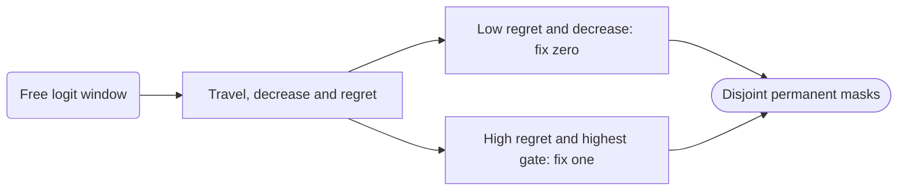

# learn/zero_one

## Objective

Continue a removal-only policy with irreversible zero and one gates. Keep original head IDs and functional widths.

## Data flow

Restore the parent removal policy and its committed window. Add an empty fixed-one mask.
Each event receives 51 post-update logit snapshots for a 50-update interval.

## Organization logic

Reuse the removal selector. Fixed-one candidates require positive travel and regret at least the high threshold.
Sort by decreasing FP32 sigmoid gate, decreasing regret, then original block and head ID.
Each branch requests its ceiling percentage of the original head count. Clip only to eligible candidates.
For 1,536 heads, fractions 0.01 and 0.005 request 16 zero and 8 one decisions.
High and low regret thresholds must be disjoint. Constant trajectories are ineligible.
Migration keeps parent events in a separate immutable base. New history starts at the next interval.
For example, checkpoint 500 migrates without decisions; snapshots 500 through 550 determine the first new event.

## Invariants

Execute `free*sigmoid(alpha)+one`. Fixed-zero and fixed-one masks cannot overlap.
Protect fixed logits and clear their Adam moments after every step. Train LoRA normally.
Free-only sparsity retains the original denominator, even after the free set is empty.
Serialize base, masks, logits, window, cursor and new event history as `progressive_zero_one_v1`.
Loading recomputes eligibility, rankings, counts and all fixed coordinates. Reject changed settings.
The inherited tensor collective verifies the complete serialized policy on every rank.

## Gotchas

Regret measures reversals, not damage or usefulness. No gate-magnitude cutoff applies to either branch.
FP32 sigmoid ties use regret then IDs. Do not replace the declared gate ranking with an unrecorded score.
When the free set is empty, both branches have shortfalls and adapters continue training.
The policy owns fixed masks; the legacy legal-width selector does not participate.

## Tests

`test_zero_one_gates.py` checks threshold equality, tie order, disjoint states, original denominator,
empty free populations, migration, tampered receipts, fixed moments, checkpointed gradients and exact resume.
The fresh native gate verifies three zero and two one decisions and bit-identical parent/migrated predictions.
