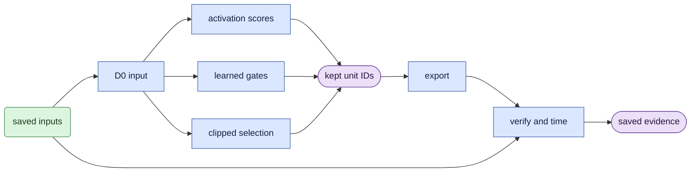

# How pruning fits together

Pruning chooses which transformer units to keep, trains recovery weights when requested, and exports the resulting computation.
Saved capture, noise and text inputs let every stage compare the same task.
The [glossary](glossary.md) defines the names below; the [algorithm](core_algorithm.md) gives the calculations.

## Parts that can change

| Method | Video self-attention (`attn1`) | Video text attention (`attn2`) | Video FFN (`ff`) | Complete blocks |
|---|---|---|---|---|
| Training-free scores | Heads | Heads | Channels | Supplied separately to depth export |
| Learned head gates | Heads | Preserved | Preserved | Preserved |
| Learned binary FFN masks | Optional head learning | Preserved | Channels | Preserved |
| Joint clipped selection with return | Heads | Preserved | Channels; disabled in the head-only control | Preserved |

The loaded transformer is video-only. Width exports preserve audio and audio-video tensors in the source checkpoint.
Depth export deletes all tensors inside removed blocks, including audio and audio-video branches.
Width pruning preserves residual feature width and original Q/K normalization.

## Three method families

**Training-free selection** observes sampled activations before output projections.
It ranks heads and channels by an RMS proxy, then removes a requested fraction in each branch.
There is no recovery optimization. A depth experiment supplies its own block list.

**Learned gates** train head scores and low-rank adapters against official velocity targets.
Head learning progresses through soft amplitudes, legal binary selection and compact recovery.
The FFN variant uses aligned binary channel counts during selection, followed by fixed-mask recovery.
The [head phase contract](learn/heads.md) gives inputs, decisions and outputs for each phase.

**Joint clipped selection with return (V3)** is the current joint method.
It observes score movement in windows, removes persistent candidates and lets strongly recovering units return.
It then aligns FFN widths and trains adapters with fixed choices.
The [selection contract](learn/readmission.md) explains policy state, reset and resume.

## Shared path

The diagram shows shared inputs and outputs, using the [diagram legend](core_algorithm.md#diagram-legend).
Every native forward keeps its first latent frame clean because that frame conditions the remaining video.
A configured optimizer crop changes the training span; calibration and evaluation keep their full saved clips.

## Next steps

Use the [run guide](usage.md) to prepare inputs and launch a workflow.
Use the [export contract](score/export_pruned.md) to choose storage and execution modes.
Use the [evidence gates](VALIDATION.md) to decide which claims the saved results support.
The [file map](README.md) and [change-impact map](ARCHITECTURE.md#change-impact-map) guide maintenance.
