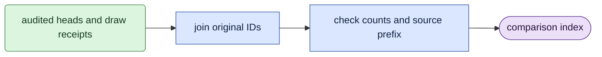

# Native-gate comparison records

## Objective

`score/native_gate_records.py` indexes original-head comparisons and physical worker provenance.
It reads saved audit/review evidence. It does not load a model or execute a native-score mask.

## Usage

Run directly on CPU from `LTX-2`, in `ltx`, after the requested milestones pass their independent reviews.
The avatar queue does not own this reader.

```bash
conda activate ltx
python -m scripts.prune.score.native_gate_records \
  --root ../expr/refiner_prune/2.5/native_head_gate_stats_20261018_exec_isolated \
  --through-step 400
```

`--root` selects the frozen study. `--through-step` requires every 100-step prefix through that endpoint.
Outputs live in `comparison/step_0100/` through the requested step, plus `comparison/index.json`.
See the [native-gate run guide](../usage.md#native-head-gate-statistics).

## Data flow

Check the frozen study identity and mask-file hash.
Read each prefix's passing audit, pinned head records and pinned event correlations.
Join each head by its original block/head pair, independent of row order.
Join each draw to its verified worker shard and original input receipt.
Publish the index only after every requested prefix passes.



## Organization logic

`disagreements` requires every original ID once and checks each learned label against the frozen mask.
It checks native-list counts globally and within each block.
Each sigma and the equal-sigma score get separate global and within-block lists.
Lists distinguish both methods, learned-only, native-only and neither.
These lists remain offline comparisons.

`export_records` requires every retained source draw once.
The physical GPU must match the frozen worker assignment and the draw's source window.
Original receipt hashes and the cumulative receipt chain must match the audit.
For example, step 400 has 640 observations, 160 per sigma, from 1,600 scheduled records.
Retained source IDs range from 1 to 1,598; skipped records are not renumbered.

Each prefix exports `head_records.json`, `disagreements.json`, `event_correlations.json` and `draw_workers.json`.
Worker records name the physical GPU, immutable shard hash and original receipt path/hash.
They also give minimum/maximum source draw IDs, per-sigma counts and the receipt-chain hash.

## Invariants

- No model, torch, decoder or queue owner is imported.
- Original IDs and exact sigma order remain unchanged.
- Missing or duplicated heads/draws cannot enter a published index.
- Original receipts, review outputs and source statistics remain unchanged.
- This index does not replace the full statistic audit or E0.

## Gotchas

A native-only list means disagreement with a saved recipe, not evidence of safe removal.
The physical worker identity comes from its verified shard.
Original input receipts retain view, seed, logical rank, crop, context and noise identities.
The index points back to those receipts instead of creating another input producer.
A failed later prefix does not publish a newer index.

## Tests

`tests/test_native_gate_records.py` checks row permutations, duplicate IDs and per-block count errors.
It checks exact source indices, physical workers, receipt hashes and missing-draw rejection.
All synthetic fixtures stay in temporary directories.
